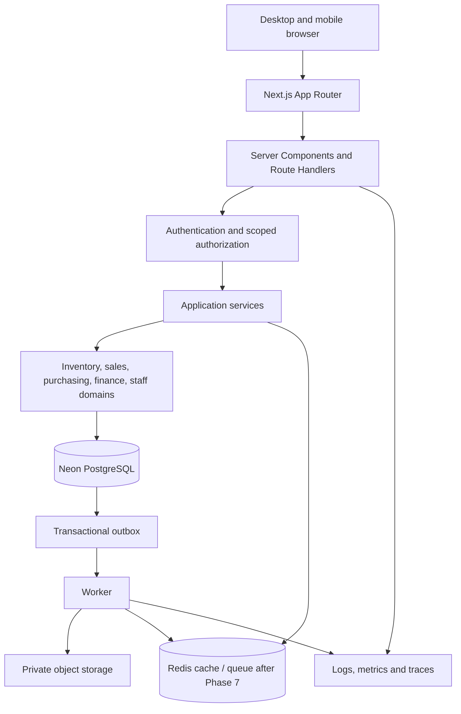

# Multi-company distribution management software

## Coding-agent implementation guide and delivery checklist

**Prepared:** 27 September 2026  
**Updated:** owner-confirmed daily DSR product summaries without a customer module; monetary SR loans, SR incentives paid by the distributor, DSR salary recovery with carry-forward/credit, and product-level supplier damage replacement. Retains Neon PostgreSQL, SSOT, dependency/change-control rules, Bangla and online-only mobile UX.  
**Source analyzed:** `Drinko 2026.xlsx`, all 12 monthly worksheets; final workbook review completed 27 September 2026  
**Requested stack:** Next.js with server-side APIs + **Neon PostgreSQL**; Redis introduced after a correct, measured database implementation  
**Delivery sequence:** interactive JSON prototype → client approval of screens and actions → secure database/API implementation → operational verification → Redis and measured optimization → opening-data migration and launch.

This is an implementation specification, not a claim that the application has already been built. Checkboxes represent work still to do. Workbook labels, notes, and formulas were treated as business evidence, not as instructions. The workbook was read without modifying it. The final review adds cross-month catalog discovery, signed staff balances, separate SR monetary accounts and supplier incentive-product history, separate damage reconciliations, and corrections to daily/person-level sales reporting. Owner-confirmed requirements take precedence over ambiguous workbook labels; proposed software rules are identified separately from source observations.

### How the coding agent must use this guide

1. Start with **Phase 1: design and interactive JSON prototype**. Do not begin by connecting a production database or implementing Redis.
2. Read the workbook findings and decision register before designing workflows. Preserve the business requirements; do not reproduce spreadsheet defects.
3. Maintain `docs/decisions.md`, `docs/client-approval.md`, and `docs/implementation-status.md` in the future project repository. Generate `docs/action-catalog.generated.md` from the typed action registry; approval records reference its stable IDs.
4. Implement one demonstrable vertical workflow at a time. Record evidence against the acceptance criteria before marking a checklist item complete.
5. Client approval of UI and actions is a required gate before production API integration, as requested by the project owner. Approval must identify the prototype version and reviewed actions.
6. Implement the confirmed rules in section 3 and their canonical workflows. AB is intentionally excluded. Owner review of actual opening quantities, costs and balances is data validation, not permission to reinterpret these business rules.
7. Every financial example in this document is a proposed acceptance scenario unless explicitly attributed to a workbook cell. Demo amounts are not opening balances.
8. Do not build a generic ERP, microservice fleet, or programmable formula engine. Build the distribution workflows described here with explicit extension points.
9. **Section 21 is the mandatory engineering rulebook.** Establish its source-of-truth ownership, module boundaries, dependency registry and CI checks before adding production workflows. A change is incomplete until its affected dependencies and compatibility checks are recorded.
10. The architecture reduces change risk through enforced ownership, contracts, tests, migrations and monitored releases. It cannot promise that every future change is harmless. This document specifies required safeguards; they become guarantees of behavior only to the extent implemented and verified.

## Contents

1. Product objectives and boundaries
2. Workbook analysis and replacement map
3. Confirmed business rules and implementation decisions
4. Company model and workspace switching
5. UI/UX specification
6. JSON prototype and client approval
7. System architecture and stack
8. Data model and constraints
9. Batch, price, quantity, and inventory rules
10. Accounting and financial integrity
11. SR/DSR operations and settlement
12. Authentication, authorization, and security
13. API contracts and transaction processing
14. Reports and reconciliation
15. Redis, queues, and performance
16. Opening-data onboarding
17. Step-by-step implementation checklist
18. Acceptance scenarios and test strategy
19. Deployment and operational readiness
20. Coding-agent delivery contract
21. SSOT, reusable UI, dependency governance and safe change rules
22. Official technical references

---

## 1. Product objectives and boundaries

Build a fast distribution workspace where users record a business event once and the system derives stock, money, staff settlement, and reports from it.

| User objective | Product response | Evidence of success |
|---|---|---|
| Reduce data-entry time | Keyboard-driven line entry, carton/piece conversion, saved defaults, recent products, reusable draft templates | Time representative users completing a 10-line purchase, sale, and route settlement |
| See reports quickly | Searchable report center, saved filters, drill-down to source documents, indexed queries | Measure report response times on realistic data |
| Less input, larger output | One posted transaction updates inventory, financial ledgers, party balances, and related reports | Demonstrate one transaction across all affected screens without re-entry |
| Data security | Server-enforced permissions, company isolation, audit history, secure sessions, backups | Negative authorization tests and a successful restore exercise |
| Quickly switch company | Persistent company selector, distinct accessible themes, scoped products/modules/permissions | No old-company data or drafts appear after switching |
| Correct batch profit and stock | Explicit stock allocations and immutable price/cost snapshots | Different-cost lots, returns, damage, and historical reports reconcile |

### Initial production scope

- Company/workspace configuration and module availability.
- Users, dynamic roles, action permissions, and company memberships.
- Product catalog, SKU aliases, carton/piece units, one shared distributor godown and internal staff/route stock custody.
- Suppliers, supplier representatives, distributor staff and optional route labels; no customer/shop master or customer invoice workflow.
- Purchase receipts, supplier bills/payments, company goods outstanding, and free supplier-incentive stock receipts without cash payment.
- Batch inventory, daily DSR sales summaries, Samari issue, Firot unsold return, damage intake, supplier replacement and stock counts.
- Supplier-employed SR delivery/dues tracking with manual settlement, and distributor-employed DSR operations with salary-based due recovery.
- Cash/bank movements, aggregate sales dues, supplier balances, SR loans/payables/incentives, expenses and DSR salary records.
- Product-and-batch damage claims with partial supplier replacement receipts and outstanding replacement quantities.
- Reports, opening balances, exports, audit history, and period closing.

### Later only if confirmed

- Native mobile apps, GPS tracking and external supplier integrations. Offline use is explicitly excluded from this project.
- Full statutory payroll, jurisdiction-specific tax filing, manufacturing, and ecommerce.
- Multiple currencies and cross-currency consolidation.
- Advanced promotions, forecasting, and separate analytics infrastructure.

Bangla is the required default user-interface language, and all operational screens must be mobile responsive. The application is online-only: no offline mode, offline transaction queue, background sync, service-worker data cache, or offline draft store. Connection loss disables server-dependent actions and shows a Bangla reconnect message; current in-memory form values may remain visible, but they are not represented as saved. Server-saved drafts are available after reconnecting.

## 2. Workbook analysis and replacement map

### 2.1 What was inspected

All monthly sheet XML was inspected for populated cells, labels, formulas, saved values, and cross-sheet references. Shared formulas were expanded for selected detailed traces. The workbook contains **356,742 cells with a value or formula, including 314,894 formula cells**, across January–December 2026. January's primary product list occupies `B7:B39`, with 33 labeled rows. Across the twelve primary grids there are **38 distinct trimmed product labels**, not necessarily 38 distinct SKUs; lower grids contain further aliases/conflicting names. The 33 January opening rows are not the complete catalog. See sections 2.6 and 16.3a.

These are storage/structure counts, not transaction counts. Blank-formatted cells are excluded. The workbook was not recalculated in Excel, and its saved results may be stale. No cells marked as cached Excel errors were found in the scan; some formulas have no saved result, and this does not establish that the formulas or business calculations are correct. Empty formula caches remain unknown, not zero. The source file has SHA-256 `7b32fea8b7a306008b78b0c18a3445cb4d9488bf039a6259d25544cba489a882`; retain this with the import provenance. Workbook drawing parts contained no additional text, and no embedded media, comments, macros or external-link parts were found in the ZIP-part inspection.

| Sheet | Cells with value/formula | Formula cells |
|---|---:|---:|
| Jan 2026 | 20,884 | 16,116 |
| Feb 2026 | 20,897 | 16,123 |
| Mar 2026 | 23,542 | 18,419 |
| Apr 2026 | 32,435 | 26,482 |
| May 2026 | 32,861 | 29,892 |
| Jun 2026 | 33,027 | 29,913 |
| Jul 2026 | 33,242 | 29,868 |
| Aug 2026 | 33,326 | 29,878 |
| Sep 2026 | 32,295 | 29,549 |
| Oct 2026 | 31,423 | 29,552 |
| Nov 2026 | 31,405 | 29,551 |
| Dec 2026 | 31,405 | 29,551 |

The file title says Drinko; `Jan 2026!G3` says PRAN. Treat this as a catalog/workspace naming question. Do not infer the legal business name from either label.

### 2.2 Business structure observed

The sheet combines several different kinds of records in one wide layout:

- Daily product movement and prices, repeated horizontally in roughly 19-column blocks.
- Product rows with receipt, issue/dispatch, return, damage, sales, profit, and ending stock.
- Carton and loose-piece entry grids beneath the product summary.
- Product-level monthly totals at the right.
- Day-level sales, dues, collections, expenses, and staff differences in nearby columns.
- Salary/commission calculations and monthly overheads, with layouts changing over time.
- Previous-month carry-forwards embedded in formulas.

**Design implication:** product summaries, daily cash settlement, staff settlement, and compensation are separate entities. A common spreadsheet row number does not make them the same business record.

### 2.3 Evidence-to-module mapping

| Workbook evidence | Observed meaning or ambiguity | Software module |
|---|---|---|
| `Jan 2026!B5:U5` | Product, due quantity, balance quantity, due price, receipt, purchase price, Samari, Firot, delivery, damage, selling price, profit, stock | Purchases, inventory, dispatch, sales, returns |
| `Jan 2026!K44:P47` | Cartons + loose pieces; returns have their own quantity entry | Product units and fast line-entry grid |
| `Jan 2026!VT5:WC5` | Monthly receipt/sales/profit, stock value, cartons, product sales, damage amount | Report center with explicit metric definitions |
| `Jan 2026!WD5:WF5` | Company damage received/paid amounts; Banking Amount means deposits made by the distributor to supplier companies, confirmed by owner | Supplier damage claims and outgoing supplier deposits/payments; not the distributor's bank balance |
| `Jan 2026!WG5:WJ5`, `WI6`, `WI42` | Daily amount fields and opening/cumulative due arithmetic | Aggregate market-sales dues and supplier open items; Credit collects previous dues, separately from personal staff loans |
| `Jan 2026!WK5:WV5` | Commission, operating costs, named SR/DSR shortages/excess, manager, totals | Separate external SR dues and internal DSR settlement; expense categories and DSR compensation |
| `Mar 2026!J44`, `Q44`, `J80` | Named people attached to issue/return grids | Person/assignment records; confirm each person's actual SR/DSR function before mapping |
| `Apr 2026!XA5:XG17` | Salaries, cash payable, AB, expenses, profit, commission history | Salary, distributor-paid SR incentive and supplier-gifted incentive stock history; AB is deferred and excluded |
| `Feb 2026!D7`, `T7` | Previous-month outstanding quantity and stock carried forward | Opening records plus immutable movement ledgers |

### 2.4 Representative formula traces

These traces explain the existing workbook. They are not automatically the new business specification.

| Cells | Observed formula/result | Implementation consequence |
|---|---|---|
| `Jan 2026!M45` | `K45*24+L45`; 7 cartons become 168 pieces | Store per-product conversion factors |
| `Jan 2026!M46` | `K46*96+L46`; 4 cartons + 12 pieces become 396 | Never assume all cartons have 24 pieces |
| `Jan 2026!K7`, `L7`, `M7` | Issue 168, return 48, net delivery `K7-L7` = 120 | Separate dispatch, unsold return, and completed sale |
| `Jan 2026!P7`, `Q7`, `S7` | With no damage: revenue 3,000; cost 2,817.60; difference 182.40 | Distinguish sales revenue, COGS, and gross profit |
| `Jan 2026!T7`, `U7` | `43674+G7-M7`; ending quantity multiplied by current `H7` price | Embedded opening quantities and single-rate valuation cannot preserve multiple lot costs |
| `Jan 2026!WU7` | Sales/credits/excess less dues/commission/cost/shortages | Cash reconciliation needs event-level sources and agreed signs |
| `Jan 2026!WI42` | `WI40-WJ40`; `WI40` includes opening `WI6` | Opening party balances must remain distinct from new invoices/collections |

The owner confirmed that due quantity means products still not received from the supplier company. `D7=8+C7-G7` is a quantity roll-forward; `WI42` is monetary. SR Sort is a personal money loan, not undelivered goods. These use separate records, units and settlement commands. Credit means collection of previous monetary dues.

### 2.5 Defects and ambiguities to resolve

| Finding | Exact evidence | Required response |
|---|---|---|
| Date labels conflict with sheet year | `Jan 2026!M4` = `01.07.025`; other row-4 dates also contain 025 | Select an explicit go-live date; never parse historical transaction dates from these labels automatically |
| Staff net quantity uses multiplication in one section | `Apr 2026!J82=F82*I82`; 192 issued × 120 returned = 23,040, while `J46=F46-I46` | Samari minus Firot is confirmed; expected net quantity is 72, not 23,040; use a regression test |
| Product rows do not align between grids | January `B35` = Sun Drop 200ml, but `B73` = Oliver Cake; `K35` inherits a link to `M73` | Use stable product IDs and explicit mappings; never join by row offset |
| Carton factors differ within a product's issue/return section | `Mar 2026!F109=D109*72+E109`, `I109=G109*24+H109` | Confirm pack definitions; snapshot conversion factors on every transaction |
| Negative saved stock | `Jan 2026!T14=-53`, `T28=-53`, `T32=-12` | Reconcile physically before opening import; production default blocks negative available stock |
| Later sheets reference April balances | `Dec 2026!T7='Apr 2026'!VS7+G7-M7`; `D7` also references April | Do not treat later tabs as verified period continuations |
| Purchase amount and cost use different price columns | `Jan 2026!I7=E7*G7` but sales cost uses `H7`; `E15=103` and `H15=96.5` | Keep source price evidence; production entry explicitly separates order/reference price, actual supplier bill price and receipt valuation. Never copy a disputed source price into historic layers without owner adjustment |
| Damage is mixed into net sales formulas | `Jan 2026!P9=(M9-N9)*O9`; stock `T9` deducts full `M9` | Separate unsold return, completed sale, damaged-product exchange and supplier replacement; exchanges do not automatically cancel revenue |
| Header names/layouts change | January named SR/DSR columns; later salary and commission sections shift | Staff and compensation are records, not database columns named after people |
| Mixed-period and prefilled formulas | All 12 tabs contain formulas and later tabs include earlier-month links | Do not assume all populated months contain finalized actuals |

Do not import workbook historical profit totals as an opening financial truth. The user's requested cutover is opening data only; use validated opening records and new events thereafter.

### 2.6 Additional findings from the final twelve-sheet review

The following are source observations. They qualify the replacement design; they do not authorize importing historical activity or treating a worksheet formula as an approved accounting rule.

| Finding | Verified source evidence | Required software treatment |
|---|---|---|
| Catalog changes within the year | `Feb 2026!B12` Surjo 30 grm; `B38` Joniur Biscut; `Mar 2026!B25` mama 5 tk; `May 2026!B39` Sun Drop Orange; `Sep 2026!B33` Sun Drop Orange250 | Discover all monthly and lower grids. Review aliases and distinct SKUs explicitly; do not inherit quantities, prices or batch identity from a prior occupant of the same row |
| Lower grids disagree with the primary catalog | `Mar 2026!B74` Wafer 5tk while `B36` is Lolipop; `Jun 2026!B107` Sun Drop Or 250ml; January `B38` Oliver Cake links through `K38=M76` to Joniur Biscut | Stage source-to-product mappings with evidence. A missing primary name or similar spelling is not authority to merge products |
| Daily sales references cost for one day in eleven sheets | January `WH34=TJ40`, where `TJ5` is Total Purchase Price; the sales column is `TI`. Saved `TI40=28602.08`, `TJ40=27334.0796`. Monthly sales `VU40=1005235.95`, daily-sales sum `WH40=1003967.95`. The same wrong-column pattern occurs in February, May, June and August–December; March/April use `WI34=TK40`, also a cost column | January's wrong reference accounts for approximately 1,268 of discrepancy, allowing for saved-result rounding. Derive daily/monthly sales from the same posted sales lines; do not reproduce this cash-summary formula |
| Staff settlement can be negative | `Jan 2026!WQ42=(WQ40-WR40)-WQ41=-35`; `May 2026!WQ42=-1909` | Show a signed statement with separately classified receivable, credit and unexplained variance. Never convert a negative source balance into a salary deduction, bonus, or confirmed refundable balance without review |
| Staff columns mix salary and operational differences | `Jan 2026!WQ39=11200` enters the shortage-column total; `Apr 2026!XB9=8000` salary, `XC9=4566` Cash Pabe, `XD9=1199` AB, but `XE9=WV42+XC9=12566` | Do not reconstruct payroll from column totals. AB is excluded; person mappings use dynamic master records; accrue agreed salary once, recover approved dues once, then pay the remainder |
| Legacy commission history mixes unrelated flows | `Mar 2026!XF6=7491`; `XF7=(XF6+XE7)-(WL7+WN7+WP7)=7163`. `Apr 2026!XI6` carries March `XF39`; `May 2026!XH39=-17548` | The owner explicitly rejected a connection between D:Comition and supplier incentive products. Preserve this formula as legacy evidence only; do not implement its mixed running balance. SR payments/loans affect actual cash and SR accounts; supplier free products affect stock and their own receipt history. See section 11.8 |
| Damage has two different closing calculations | `Jan 2026!WC42=WC40-WD40=4572.8832`; `WD42=WD40-WE40=0` | Retain both source amounts only as evidence. The confirmed replacement process is product-based; do not create supplier cash-payment requirements from these old labels. Track buyer replacement pending and company replacement pending separately |
| Person/product monthly amount uses the last price | `May 2026!VT45=VS45/24` (carton equivalent), `VU45=VM7`, `VV45=VS45*VU45`; person total `WA45=VX45*VZ45`, with `VZ45=VU45` | Retain product/person/month quantity reporting but calculate actual revenue as the sum of immutable sale-line amounts. CV is a carton-equivalent calculation here, not currency. The last-day rate is not the rate for every sale |
| Cross Check is not a pass/fail reconciliation | `Jan 2026!S42=P40-Q40` gives profit 542.9932; `VV43=VV40-WT40` gives 43789.449 | Build independent ledger/control reconciliations. Do not label these source amounts as zero-residual checks or proof of correctness |
| Some profit deductions are manual | `May 2026!WZ16` says 31 Date Profit(-), with `XD16=1209`; `WZ17` Flour Stock Sort, with `XD17=13315` | Investigate source events. A confirmed stock shortage uses a count/write-off with batch and quantity; a money-only correction is a reviewed journal. Neither is an editable profit-total field |

Seed reviewable expense labels from the workbook: godown rent (`Jan 2026!WK38` / `WL38=14000`), garage (`WK39` / `WL39=2000`), loading/unloading (`Apr 2026!XA16`) and Eid-related expense (`XA17`, `XE17=6000`). These are proposed categories, not recurring approved amounts or automatically imported opening liabilities. Determine whether each cost belongs in overhead, landed inventory cost or employee compensation before posting; link a payroll-related bonus rather than recording the expense twice.

## 3. Confirmed business rules and implementation decisions

These rules supersede provisional interpretations of the spreadsheet. The owner explicitly deferred **AB**: exclude it from v1 forms, payroll and financial calculations. Retain its original cells only as import evidence; do not invent its meaning or make AB a launch dependency.

| ID | Rule | Implementation |
|---|---|---|
| D01 — CONFIRMED | Companies are supplier brands under one distributor | One accounting entity; brand workspaces share eligible cash/staff and one godown |
| D02 — CONFIRMED | SR is supplier-employed; DSR is distributor-employed | SR salary excluded; distributor-paid SR incentive is a separate business expense, not SR payroll |
| D03 — CONFIRMED | One daily product summary per DSR; no customer module | Brand/date/DSR summary with product, batch allocations and actual-price splits; no customer tables, customer invoice form or shop-level statements |
| D04 — CONFIRMED / DEFERRED | Samari = products issued for selling; Firot = unsold returned; Credit = old-dues collection; AB deferred | Issue/return are custody events. Collection settles an existing aggregate due and is not new revenue. AB has no effect |
| D05 — IMPLEMENTATION DEFAULT | FEFO for known expiry, otherwise FIFO by receipt | Authorized batch override with reason; immutable actual allocation |
| D06 — IMPLEMENTATION DEFAULT | Actual receipt cost layers | Same manufacturer lot can have multiple receipt costs; sales prices are transaction snapshots |
| D07 — DECIDED | Excel baseline, owner-adjusted cutover | January carry-in rows prefill opening; actual cutover stock/costs and additional dynamic products are owner-reviewed |
| D08 — CONFIRMED / DECIDED | Bangla, BDT, Asia/Dhaka, no tax invoice in v1 | Mobile UI/prints; decimal money; 2-place settlement, 6-place cost precision |
| D09 — IMPLEMENTATION DEFAULT | Shared distributor staff/cash; brand-attributed events | No duplicated balances; one summary per brand/DSR/business day |
| D10 — DECIDED | One shared godown | Internal DSR custody/quarantine; no multiwarehouse administration |
| D11 — CONFIRMED | DSR personal due recovered from salary; remainder carries | Cap recovery at eligible pay; never negative cash salary. Excess money is refundable or retained as DSR credit |
| D12 — IMPLEMENTATION DEFAULT | Source-based corrections/returns | Use original summary and batch allocations when known; unknown legacy return uses reviewed evidence/quarantine, never invented source history |
| D13 — IMPLEMENTATION DEFAULT | Period locks and approval controls | Current open periods; approved price/correction/adjustment overrides, optimistic concurrency and idempotency |
| D14 — CONFIRMED | Neon PostgreSQL | Region/hosting sizing validated with benchmarks; Redis added after SQL correctness/performance |
| D15 — CONFIRMED | Online only and responsive mobile | No offline posting, offline queue or operational local storage |
| D16 — CONFIRMED | Company incentive is free product stock | Receive product/unit/quantity/batch with explicit value; cash and supplier payable stay unchanged. Distinguish standalone incentive from bonus quantity attached to a paid purchase |
| D17 — CONFIRMED | Buyer returns damage; distributor replaces it or keeps replacement pending; company replaces goods returned to it | Separate buyer and supplier replacement legs, tracked by product/quantity/batch; no normal cash refund or supplier cash reimbursement flow |
| D18 — CONFIRMED | SR Sort = SR borrowed money; SR Over = distributor owes SR | Separate loan receivable and SR payable. Loans reduce that day's available cash/running balance, not recognized product sales revenue |
| D19 — CONFIRMED | Banking Amount is outgoing deposit to supplier | Funding account decreases; allocate to bill or supplier advance; never treat as own bank balance |
| D20 — CONFIRMED | D:Comition and supplier incentive products have no accounting connection | D:Comition is distributor↔SR expense/payment; loans and repayments stay in SR/cash accounts. Free incentive products are supplier company→distributor inventory receipts. No cross-deduction, cross-offset or shared incentive running balance |
| D21 — CONFIRMED | Buyer gets product replacement, pending if unavailable; unpaid shop sales stay separate from personal DSR dues | Anonymous return-case reference/DSR link without customer master; aggregate market due never enters payroll automatically |
| D22 — CONFIRMED | Products dynamic per company, with batch and variable prices | No hardcoded 33/38-product limit, fixed staff columns or inherited row identities; opening importer uses explicit mappings |

The prototype approval gate checks usability and actions, not questions already answered here. Opening control totals and actual lot quantities still require normal owner review. The owner has confirmed the business meanings below; AB alone is intentionally deferred and excluded. In particular, never connect SR incentive/loan accounts to supplier incentive-product balances merely because the spreadsheet formula combines them.

### 3.1 Required Bangla business vocabulary

| Meaning | UI label |
|---|---|
| Products issued to DSR / Samari | বিক্রির জন্য দেওয়া পণ্য (সামারি) |
| Unsold goods returned / Firot | অবিক্রীত পণ্য ফেরত |
| Goods not yet received from supplier | কোম্পানি থেকে পাওনা পণ্য |
| Old monetary dues collected / Credit | আগের বকেয়া আদায় |
| SR loan given / SR Sort | এসআরকে দেওয়া ধার |
| Outstanding SR loan | এসআরের কাছে পাওনা |
| Money distributor owes SR / SR Over | এসআরকে দিতে হবে |
| SR loan repayment | এসআরের ধার ফেরত |
| Distributor-paid SR incentive | এসআর ইনসেনটিভ প্রদান |
| Free company incentive products received | কোম্পানি থেকে ইনসেনটিভ পণ্য গ্রহণ |
| Supplier incentive products received | কোম্পানি থেকে পাওয়া ইনসেনটিভ পণ্যের হিসাব |
| Remaining supplier-incentive stock | ইনসেনটিভ পণ্যের অবশিষ্ট স্টক |
| DSR personal recoverable balance | ডিএসআরের কাছে পাওনা |
| Deducted from salary | বেতন থেকে সমন্বয় |
| Due carried forward | পরের মাসে বকেয়া |
| DSR excess credited | ডিএসআরের জমা টাকা |
| Refund excess to DSR | ডিএসআরকে টাকা ফেরত |
| Damaged goods intake / sent to company | ড্যামেজ পণ্য গ্রহণ / কোম্পানিতে ড্যামেজ ফেরত |
| Company replacement due / received | কোম্পানি থেকে বদলি পাওনা / বদলি পণ্য পাওয়া |
| Product sales versus cash remaining | মোট বিক্রয় / হাতে অবশিষ্ট টাকা |
| Aggregate unpaid shop sales | বাজারের বকেয়া |
| Market collection on old dues | বাজারের আগের বকেয়া আদায় |
| Buyer replacement pending | ক্রেতাকে বদলি দেওয়া বাকি |
| Buyer replacement completed | ক্রেতাকে বদলি দেওয়া হয়েছে |

Do not display generic Short/Over or positive/negative amounts without direction and named person. A signed net may be secondary; show who owes whom as the primary label.

## 4. Company model and workspace switching

### 4.1 Separate tenant, legal entity and company workspace

- **Tenant:** the customer organization using the software. Initially one tenant is sufficient; include its ID in scoped data.
- **Legal entity:** the owner of stock and the accounting books, currency, fiscal periods, and cash/bank accounts.
- **Company workspace:** the company/brand the user selects, with its own name, logo, theme, products, modules, memberships and reporting dimension.
- **Godown/location:** one shared distributor storage site for v1, supported by the workbook's Godawon expense label. Products remain separated by brand, batch and condition. Staff/vehicle stock is internal custody, not another warehouse or owner. Keep location IDs in the schema but do not build multi-warehouse administration. The Garaj/Geraj label establishes an expense category, not a second stock location.

**Confirmed deployment:** create one distributor legal entity with several supplier-brand company workspaces. Do not create separate legal entities or duplicate cash/opening capital just because the user switches brands. The entity layer allows a future independent-business expansion, but do not build that expansion's UI for the initial release.

Products and operational documents belong to a company workspace. Financial journal lines have a legal entity and, when attributable, a company dimension. Shared overhead/cash is reported as shared/unallocated or allocated using an explicitly approved rule. The sum of company reports plus shared/unallocated amounts must reconcile to entity totals.

Each daily sales summary belongs to one brand, one DSR and one business date. The same DSR can work for several brands with separate summaries and one consolidated staff cash handover referencing the underlying collections once. Supplier payments and old-due collections retain brand/source allocations. No customer invoice or cross-brand customer master is required.

### 4.2 Switching behavior

Use routes such as `/c/{companyId}/sales`. The URL identifies the requested context, while the server verifies access independently. A cookie may remember the last workspace but is not authorization.

When switching:

1. Check membership and available modules.
2. Resolve any unsaved draft with Save draft / Discard / Stay choices. Never reassign the draft to the new company.
3. Cancel old in-flight requests and prevent late responses from updating the new workspace.
4. Mount a company-specific query/state boundary; clear selected parties, products, staff, filters that are invalid in the destination.
5. Load the authorized destination catalog, permissions and theme before displaying its data.
6. Preserve the equivalent route only when the destination supports it; otherwise open its dashboard.
7. Show company name/logo persistently in the header, forms, printed documents and confirmation dialogs.

Two browser tabs may use different companies concurrently. Avoid one mutable global “active company” session field that silently changes another tab's commands. Every command carries its company context.

### 4.3 Theme and module configuration

Store approved design tokens, not arbitrary user-provided CSS: primary, primary foreground, accent, chart accent, logo reference. Validate contrast and image upload type. Keep backgrounds, typography, spacing, validation colors and component behavior consistent.

Example themes: Drinko red, a second demo company's blue, a third green. Red branding must not replace red error text or make status depend on color alone.

Effective module visibility = enabled module ∩ authorized action(s). Disabling a module must preserve historical records; dependency rules prevent disabling inventory while stock-posting sales remain enabled. Read-only historical access is explicit.

## 5. UI/UX specification

### 5.1 Visual and interaction direction

Create a polished operational workspace: calm neutral surfaces, compact readable tables, clear totals, restrained company accents, generous spacing around decisions, and fast keyboard use. Use a consistent 8px spacing scale, tabular numerals, 14–16px desktop body text, visible focus indicators, and a tested Bangla font throughout the required Bangla UI, reports and printed documents.

Optimize common desktop layouts around 1280–1440px. Mobile screens prioritize route dispatch, delivery, collection, return, and settlement; avoid squeezing a 15-column table onto a phone. Support approximately 44px mobile touch targets and WCAG AA contrast. All important actions must work without a mouse.

### 5.1.1 Required Bangla localization and mobile behavior

Use a translation dictionary from the first prototype; do not hardcode English labels into operational screens. The guideline and source-code identifiers may remain English. Required Bangla UI examples: কোম্পানি পরিবর্তন (switch company), প্রারম্ভিক মজুদ (opening stock), কোম্পানিতে জমা (supplier deposit), বাকি (due), বেতন থেকে সমন্বয় (salary recovery), গুদাম (godown), and সংযোগ নেই (no connection).

Translate navigation, field labels, permissions displayed to admins, buttons, validation, empty/error states, confirmation dialogs, reports, print documents and exports. Preserve original SKU/product/person names and support searchable Bangla aliases. Use Unicode-normalized search; accept Bengali and Latin digits in number fields and normalize them before decimal validation. Keep stored dates as ISO/Gregorian dates and apply consistent `bn-BD` display; do not infer a different calendar from language.

Use a Bangla font such as a properly licensed bundled Noto Sans Bengali with a tested fallback. Verify glyph shaping, line wrapping, mixed Bangla/Latin numbers and embedded fonts in PDF/print output. Use stable technical error codes with localized user messages. Required mobile checks cover 360px/390px widths, touch keyboards, numeric entry, drawers, sticky totals and all posting/approval actions. Use stacked cards or focused line editors where desktop tables are too wide.

### 5.2 Navigation

```text
Company selector / global search / current user
Dashboard
Sales           DSR daily summaries · Samari issue · Firot return · Old-dues collection
Purchases       Orders · Receipts · Bills · Supplier payments · Supplier returns
Inventory       Godown stock · Batches · DSR custody · Counts · Damage · Claims
SR accounts     Supplier representatives · Deliveries · Dues · Manual settlements
DSR staff       Routes · Assignments · Issue & return · Settlements · Salary recovery
Finance         Company deposits · Cash & bank · Expenses · Receivables · Payables · Journals · Period close
Reports         Operations · Stock · Money · Staff · Reconciliation
Masters         Products & units · Suppliers · SR/DSR · Shared godown
Administration  Companies · Modules · Users · Roles · Audit · Opening data
```

Hide irrelevant navigation through configuration. Keep position/order stable across companies.

### 5.3 Essential screens and actions

| Screen | Required components | Primary actions |
|---|---|---|
| Dashboard | Date/location filters; sales, collections, gross profit if permitted, stock value, dues, unsettled routes; exceptions | New sale, receive stock, settle route, drill into a metric |
| Product list | Search by SKU/name/alias/barcode, company filter implicit, stock and units | Create/edit/archive; view batches and history |
| Product detail | Overview, batch balances, purchase/sale history, price history, movement ledger | Adjust default selling price, open batch, approved stock count |
| Purchase workspace | Supplier, receipt date, document reference, editable item grid, freight/discount, batch/expiry, totals | Save draft, receive, invoice, pay, reverse through guided workflow |
| DSR daily sales workspace | Date, DSR, product grid, issued/unsold/damaged/sold quantities, expandable batch/price splits, collections | Save, preview, post one daily summary, print; collect old dues |
| Batch drawer | Lot ID, expiry, location, available/reserved/quarantine, cost if permitted, price suggestion | Choose batch, split allocation, trace movements |
| Return/adjustment workspace | Firot custody return or source-linked sales correction; original batch/quantity and reason | Receive unsold stock or approve a summary correction; no customer credit/refund wizard |
| Damage replacement workspace | Return-case reference, DSR, product, damaged quantity/batch evidence, buyer replacement due, company dispatch/acceptance/replacement due | Receive damage, issue replacement or keep pending, send to company, receive partial replacements, close/reverse |
| SR account workspace | Brand, SR, money lent, repayments, incentive paid, money owed to SR and running cash balance | Give loan, record repayment, pay incentive, settle SR payable; no product due or SR salary |
| DSR day workspace | The same daily-sales workspace with issue/return, damage and settlement tabs; separate market due and personal due | Reuse the same summary/line editor and commands; no duplicate sales form or posting flow |
| Settlement review | Expected vs counted cash, stock reconciliation, shortage/excess, reasons, linked transactions | Request correction, approve, post, view outstanding differences |
| Company deposits | Supplier brand, amount, date, funding account, bank/deposit reference, allocation and remaining advance | Record deposit, allocate to supplier bill, reverse with audit trail |
| Cash/bank | Actual distributor funding accounts, dated movements and reconciliation status | Receive/pay; inspect outgoing supplier deposits |
| Opening wizard | Cutoff, products/batches, party balances, staff custody, cash/bank, validation, preview | Save, import preview, reconcile, approve, activate |
| Roles | Module/action matrix, scope, sensitive-field permissions, effective-permission preview | Create role, assign members, preview impact, save |
| Supplier incentive-product statement | Supplier/company, product/batch, received quantity/value, receipt/reversal history and remaining stock | Receive free stock through procurement; drill into receipt/layer/stock history; no SR money fields |
| Catalog import review | All-month source labels, aliases, conflicting rows/units and unresolved mappings | Match existing product, create distinct SKU, mark source error, review actual opening stock |
| Reports | Saved filters, as-of/freshness, table/chart, reconciliation totals | Drill down, export, print |
| Audit | Actor/time/company/action/document and redacted change details | Search/filter; open related document |

### 5.4 Fast entry requirements

- Autofocus meaningful fields; Enter advances cells, Tab follows a sensible order, keyboard shortcuts are discoverable.
- Product selection fills unit, default selling price, preferred batch policy and last used settings; it does not post anything.
- Allow cartons and pieces in one line and show computed base quantity live.
- Keep net amount, total, payment and balance visible in a sticky footer.
- Allow paste from a grid with row-level validation and an import preview.
- “Repeat last order” copies a draft template only; refresh stock and suggested prices and require review before posting.
- Recent/favorite products are scoped to the user and company.
- Select a DSR and date once; load their issued products and enter only unsold returns, damage, actual price changes and collections. No customer entry step.
- Reusable route templates fill staff and common products; the user enters only changed quantities.
- Use online server autosave for drafts where approved, with an obvious saved/pending/error state. Do not persist operational drafts in browser storage for offline use.
- Never show a posted daily-summary/receipt number or success state before the authoritative posting response.
- Unknown request outcome offers Check status / Retry with the same request key, not blind duplicate submission.

### 5.5 Screen states

Every screen must include: loading skeleton, empty state, valid data, field errors, forbidden action, unavailable module, stale version conflict, connection loss, and server failure. Transaction screens also need insufficient stock, locked period, missing batch, over-return, and price-approval states.

Distinguish Samari issue from completed sale, Firot from damaged-product exchange, market unpaid sales from DSR personal due, and collection from cash handover. Use the Bangla labels in section 3.1 throughout.

## 6. JSON prototype and client approval

### 6.1 Prototype rules

Use local, deterministic JSON fixtures with a mock service adapter. The prototype must support stateful actions and derived reports; it must not be only static screens. Show a persistent **Demo data** indicator and a Reset demo action.

Create synthetic parties and people. A small sanitized product catalog may use workbook product names for familiarity. Do not embed actual supplier/staff financial balances in a shareable demo.

Use the same command/query DTO shapes for mock and production adapters. Share pure decimal calculations and validation schemas where appropriate. Never put a security-sensitive server module into the client bundle to obtain code reuse.

```text
packages/contracts/    DTOs, validation schemas, canonical public action/permission IDs
packages/domain/       Pure quantity/money/calculation rules
apps/web/src/features/ Screens and workflow components
apps/web/src/data/ports/ Service interfaces
apps/web/src/data/mock/  JSON seeds, deterministic mock service
apps/web/src/data/http/  Production HTTP adapter, added after approval
apps/web/src/demo/       Scenario selection and reset tooling
```

### 6.2 Illustrative seed JSON

Money and decimal quantities travel as strings. IDs below are demo identifiers; production uses immutable generated IDs. Date, currency and locale are proposed demo defaults.

```json
{
  "schemaVersion": 1,
  "mode": "demo",
  "tenant": { "id": "tenant-demo", "name": "Distribution Demo" },
  "legalEntities": [
    { "id": "entity-1", "currency": "BDT", "timezone": "Asia/Dhaka" }
  ],
  "companies": [
    {
      "id": "drinko", "legalEntityId": "entity-1", "name": "Drinko",
      "theme": { "primary": "#B42318", "primaryForeground": "#FFFFFF" },
      "modules": ["sales", "purchases", "inventory", "staff", "finance", "reports"]
    },
    {
      "id": "demo-foods", "legalEntityId": "entity-1", "name": "Demo Foods",
      "theme": { "primary": "#1D4ED8", "primaryForeground": "#FFFFFF" },
      "modules": ["sales", "purchases", "inventory", "finance", "reports"]
    }
  ],
  "products": [
    { "id": "drink-250", "companyId": "drinko", "sku": "DR-250",
      "name": "Drinko 250ml", "baseUnit": "piece", "piecesPerCarton": "24" },
    { "id": "demo-biscuit", "companyId": "demo-foods", "sku": "DF-001",
      "name": "Demo Biscuit", "baseUnit": "piece", "piecesPerCarton": "20" }
  ],
  "openingLayers": [
    { "id": "layer-a", "companyId": "drinko", "productId": "drink-250",
      "batchId": "batch-a", "locationId": "warehouse-1",
      "quantity": "100", "unitCost": "10.000000",
      "suggestedSalePrice": "15.000000", "expiryDate": "2027-01-31" },
    { "id": "layer-b", "companyId": "drinko", "productId": "drink-250",
      "batchId": "batch-b", "locationId": "warehouse-1",
      "quantity": "100", "unitCost": "12.000000",
      "suggestedSalePrice": "16.000000", "expiryDate": "2027-02-28" }
  ]
}
```

This is a seed fragment, not the complete fixture suite. Add the one shared godown, users/roles, suppliers, SR/DSR, permissions, transactions, and ledger-derived outputs. The demo location ID `warehouse-1` represents that shared godown for both brands. The initialization routine creates opening ledger entries from these layers. Do not maintain an unrelated hardcoded dashboard total. Keep these synthetic demo seeds separate from section 16's real, editable Excel import baseline.

### 6.3 Minimum demo scenarios

- [ ] Two companies with different products, colors, module availability, and user permissions.
- [ ] One product in two cost layers with different purchase costs and sale-price suggestions.
- [ ] One sale spanning both batches; another sale from the same batch at a different price.
- [ ] Daily DSR summary, current collection, later old-dues collection and aggregate statement without customer records.
- [ ] Partial return to the original batch and original transaction price.
- [ ] Firot custody return, damaged-buyer-return case, pending buyer replacement and partial supplier replacement, with batch traceability.
- [ ] SR money loan, partial repayment, payable to SR and distributor-paid incentive, without SR salary expense.
- [ ] Internal DSR issue, delivery, collection, handover, shortage/excess and salary-based due recovery.
- [ ] Supplier damage claim partially approved and later settled.
- [ ] Opening-data review, missing-cost validation and activation preview.
- [ ] Permission denied, insufficient stock, over-return and stale draft conflict.
- [ ] Slow/error API simulation and safe recovery after an unknown posting result.
- [ ] Switching companies while a draft exists and while a request is in flight.

### 6.4 Client review gate

Maintain an action catalog; buttons without defined behavior are unfinished. Each row records:

```text
Action ID | Screen | Actor/scope | Preconditions | User inputs/defaults
Calculated values | Stock effect | Money effect | Confirmation/approval
Error cases | Reversal path | Report impact | Demo scenario
Client decision | Reviewer | Date | Prototype commit/version
```

Example: `SALE.POST` reduces allocated available stock, creates revenue/aggregate receivable and COGS entries, returns the posted daily summary, and supports a documented reversal/return path. An unsold route return creates no revenue or financial credit.

Client approval must cover every module and action, including exports, printouts, restrictions, corrections, and error states. Maintain a change-request list. A screen can be visually approved while its calculation is still pending; record these separately.

**Gate:** API integration starts only after the project owner confirms the approved prototype version and outstanding business-rule decisions are documented. Do not silently interpret a demo session as approval.

## 7. System architecture and stack

### 7.1 Recommended shape

Use a **modular monolith**: one Next.js application, one Neon-hosted PostgreSQL database per environment, and a separate background worker process sharing domain code. This keeps inventory and financial posting inside one database transaction while allowing independent worker scaling.



Redis in the diagram is optional during earlier phases. Core posting must not depend on a successful cache write or job enqueue. Persist the outbox event with the business transaction.

### 7.2 Stack decisions

| Layer | Recommendation | Purpose |
|---|---|---|
| Web/server | Supported stable Next.js App Router + React + strict TypeScript | One web app with server-side API routes |
| API | Versioned Route Handlers, Node.js runtime | Explicit contracts for browser and future integrations |
| Database | **Neon PostgreSQL**, supported stable Postgres version | Authoritative operational/financial data, transactions, constraints, exact numeric arithmetic and RLS |
| Database access | Prisma ORM with reviewed SQL migrations and parameterized SQL where needed | Typed routine queries; explicit control over locking/report SQL |
| Identity | Better Auth or an equally maintained Next.js-compatible library; default candidate Better Auth | Sessions, account lifecycle and MFA foundation |
| Authorization | Application-owned scoped permission service and DB records | Client-created roles mapped to server-known actions |
| UI | Tailwind CSS + shadcn/ui primitives | Consistent, customizable forms, drawers, dialogs and tables |
| Forms | React Hook Form + Zod | Structured forms and shared input validation |
| Client data | TanStack Query for interactive client queries/mutations | Scoped query lifecycle, retry and invalidation |
| Tables | TanStack Table; virtualization when measurement warrants it | Large operational lists without loading everything |
| Arithmetic | Decimal library + PostgreSQL NUMERIC | Deterministic costs, quantities, allocations and rounding |
| Cache | Redis, introduced after SQL baseline | Repeated safe reads and selected transient coordination |
| Async jobs | DB outbox first; BullMQ with separate Redis queue instance when introduced | Exports, PDF generation, notifications and projections |
| Files | Private S3-compatible object storage | Attachments and generated exports |
| Tests | Vitest, Playwright, real PostgreSQL integration tests, load-test tooling | Business invariants, UI workflows, isolation and performance |
| Operations | Structured logs, OpenTelemetry-compatible tracing, error reporting | Diagnose latency, failures and reconciliation issues |

Pin exact package and runtime versions during project bootstrap, check compatibility and security advisories, and commit the lockfile. Do not blindly use `latest` in deployment. ORM transaction APIs vary by version; verify locking, isolation, connection pooling and RLS behavior against the selected release.

Next.js Route Handlers provide the requested server-side HTTP API. Server Components should call the same authorized application services directly rather than making an HTTP request back into the application. [Next.js backend guidance](https://nextjs.org/docs/app/guides/backend-for-frontend).

Use a server-only data-access layer and explicit DTOs. Authentication at navigation level is insufficient; check authorization where protected data is accessed. [Next.js authentication guidance](https://nextjs.org/docs/app/guides/authentication).

### 7.3 Module boundaries

```text
apps/
  web/                 Next.js UI and HTTP adapters
  worker/              Outbox dispatcher and background workers
packages/
  architecture/        Typed ownership, action, event, resource and dependency registry
  contracts/           DTOs, enums, validation and API schemas
  domain/              Pure business rules and decimal math
  application/         Authorized commands/queries and transaction orchestration
  database/            Schema, migrations, scoped repositories, SQL
  auth/                Session integration and permission evaluation
  ui/                  Shared accessible components; imports design-system tokens
  design-system/       Semantic tokens and theme contract
  i18n/                Canonical Bangla dictionaries, number/date formatters
  observability/       Logs, metrics, trace helpers
docs/
  decisions.md
  action-catalog.md
  client-approval.md
  implementation-status.md
  operations-runbook.md
```

A smaller repository may use equivalent folders within one package. The boundaries matter more than introducing a monorepo tool. Domain code must not import React, HTTP request objects or Redis. UI code must not directly update stock or journal tables.

### 7.3.1 Initial scope limits: godown and tax invoices

The workbook contains Godawon/Godown-style expense labels (`Jan 2026!WK38`, `Apr 2026!XA14`), so include one shared godown. No separate warehouse catalog, per-company physical warehouse, inter-warehouse transfer workflow or garage inventory is established by the file. Retain internal location/condition identifiers for DSR custody and damage quarantine so stock is counted once.

No explicit tax/VAT rate, tax amount, tax-registration or tax-invoice fields were found in the inspected workbook labels. Under the owner's instruction, exclude tax calculation, VAT settings, statutory tax invoices and tax reporting from v1. Provide DSR daily-summary printouts/challans, damage replacement slips, receipts and supplier deposit vouchers in Bangla; no customer sales-invoice module. This is a product-scope choice, not a statement that transactions are legally tax-exempt. If generic contracts in this guide retain tax fields, set their v1 calculation to zero/inactive, omit them from user forms and printouts, and do not add a tax module. A later tax feature needs a separate requirement.

### 7.4 What should scale first

Start with stateless web instances, pooled database connections, short transactions, indexed reports, and bounded workers. Add replicas or separate services only when measured bottlenecks justify them. Keep inventory and financial posting together until there is a proven reason to distribute them.

### 7.5 Neon database implementation policy

Neon is the selected PostgreSQL provider. It does not replace the application service layer, provide business authorization automatically, or become a second API that the browser can use to bypass posting rules. Keep all database credentials server-side. Use one provider integration and one connection factory; do not add a parallel database provider or direct client-side database access.

#### Connections and transactions

- **Runtime default:** Next.js Node runtime and worker use a pinned Prisma version with its supported Node PostgreSQL adapter/driver over Neon's pooled endpoint. Verify the exact adapter against the pinned release before writing initialization code.
- **Migration connection:** a dedicated migration credential/connection is exposed only to the release job. This project prefers the direct endpoint for predictable administrative/session behavior and separation of privileges. This is a project policy, not a claim that Neon cannot run Prisma migrations over pooled connections; Neon documents support for that. [Neon Prisma pooling support](https://neon.com/blog/better-postgres-with-prisma-experience).
- **Interactive posting:** multi-step inventory and financial commands need one real database transaction/connection for lock → read → calculate → write. Do not split these steps across separate HTTP database calls. Neon's HTTP query interface supports single/non-interactive work; its WebSocket Pool/Client interface supports interactive transactions. Use the approved Node TCP adapter by default; a transport change requires the same transaction tests. [Neon driver guidance](https://github.com/neondatabase/ai-rules/blob/main/neon-serverless.mdc).
- Use one bounded client/pool per long-lived process/runtime instance, not a new unbounded pool per query. Set combined budgets across web replicas, worker concurrency and release jobs against actual Neon capacity. Configure connection, statement, lock and transaction timeouts; keep them compatible with request timeouts.
- With transaction pooling, set request scope using parameterized `set_config(..., true)` inside the transaction and execute every protected query through that transaction handle. This includes scoped reads. A helper that sets context on one connection then queries through a global client is forbidden.
- Use transaction-scoped row/advisory locks only where designed; do not rely on session state, session advisory locks or persistent LISTEN connections through a transaction pool. The outbox uses durable claims/leases and bounded polling, not an assumed permanent web connection.
- Do not hold a transaction open while waiting for a person, file upload, print generation, Redis or any external service. On unknown commit outcome, look up the durable idempotency outcome before retrying under the same key.

#### Runtime roles and RLS

Create dedicated least-privilege application and worker roles, with no superuser, `BYPASSRLS`, schema-creation or table-owner capability. Do not assume a default console-provided role is appropriate. Inspect `pg_roles`, table ownership and role memberships in each environment; verify both direct role attributes and effective inherited/assumable privileges. The migration role owns/manages schema separately.

An automated deployment test connects with the **actual runtime credential**, sets scope for brand A, attempts reads/writes referencing brand B, and verifies denial. It also tests unset context and pooled connection reuse. A policy's presence in schema is not evidence that the chosen role enforces it. PostgreSQL bypass/owner behavior is described in the [row security documentation](https://www.postgresql.org/docs/current/ddl-rowsecurity.html).

Example role inspection, executed by deployment checks without logging secrets:

```sql
SELECT current_user, rolname, rolsuper, rolbypassrls, rolcreaterole
FROM pg_roles
WHERE rolname = current_user;
```

This query alone is not the entire authorization test; check ownership, membership and actual access behavior too. Authentication-library tables use the exact restricted grants/paths the integration needs, not an unrestricted bypass role for the whole business database.

#### Environments and migrations

Use isolated production and nonproduction credentials and preferably separate projects/access boundaries. Create ephemeral development/PR/test branches from a sanitized template or schema-only baseline, seed synthetic data, apply the committed migration chain and run integration tests. Branches can inherit data: do not give a preview unrestricted production financial or personal data. Neon describes independent branch workflows and schema-only options in its [branching workflow primer](https://neon.com/docs/get-started-with-neon/workflow-primer).

Promote **reviewed code and migrations**, not a development database's contents. Neon database branching is not Git-style merging of production transactions. Never reset production to a preview branch to deploy a feature. Record the exact project/branch endpoint and migration version for each environment; fail deployment if the environment's identity is unexpected.

Protect production schema changes behind one serialized release job, reviewed migrations and migration-state checks. A disposable shadow database/branch for development migration tooling must never point at production. Validate SQL constraints, triggers, RLS and views as well as ORM models during migration rehearsal.

#### Performance and operations

Select Neon region near the server/worker and measure latency from the users; do not assume that an edge-deployed UI makes remote database round trips cheap. Set compute/autoscaling bounds and evaluate cold-resume latency separately from warm traffic. Proposed production default is no scale-to-zero during business operation if the chosen plan supports it; nonproduction may suspend. Outbox polling can keep a compute active, so include worker behavior in capacity/cost tests. Neon documents production/development scaling tradeoffs in its [autoscaling guidance](https://neon.com/blog/neon-autoscaling-is-generally-available).

Test connection loss/retry, concurrent posting, pooled RLS, migration with old/new application versions and restore into an isolated branch. Confirm restore retention, permissions, cost and recovery time on the chosen plan. A test branch proves correctness on that branch; it does not prove production performance or complete backup coverage.

## 8. Data model and constraints

### 8.1 Entity groups

Every tenant-owned record needs `tenant_id`. Accounting records need `legal_entity_id`; workspace-owned records also need `company_id`. Shared entity records must have explicit visibility/assignment rules rather than pretending to belong to every company.

| Group | Principal entities | Key relationships and requirements |
|---|---|---|
| Organization | Tenant, LegalEntity, Company, CompanyModule, Warehouse, StockLocation | Company belongs to one entity; location has ownership/custody rules |
| Identity | User, Session, Membership, Role, Permission, RolePermission, RoleAssignment | Assignments include tenant/company/location/route scope |
| Catalog | Product, ProductAlias, ProductUnit, PriceRule | Product code unique per company; conversions versioned |
| Suppliers | Party, SupplierAccount, PartyCompanyAssignment | Supplier identity/brand assignments only; do not implement CustomerAccount or a placeholder customer |
| Staff | Staff, StaffCompanyAssignment, Route, RouteAssignment | Staff ID independent of login; assignments effective-dated |
| External SR accounts | SupplierRepresentative, SRLoan, SRRepayment, SRPayable, SRSettlementAllocation, SRIncentive | Money-only loans/payables; incentive expense/payment links; company product outstanding stays in procurement |
| Procurement | PurchaseOrder, OrderLine, GoodsReceipt, ReceiptLine, SupplierInvoice, InvoiceLine, ReceiptInvoiceMatch, SupplierIncentiveReceiptDetail | GoodsReceipt kind distinguishes purchase, free supplier incentive and damage replacement. Only billed purchases create supplier liability; each receipt creates stock once |
| Batches | ProductBatch, ReceiptCostLayer, PriceSuggestionHistory | Same physical lot may have several receipt cost layers |
| Daily sales | DailySalesSummary, DailySalesLine, Dispatch, DispatchLine, StockAllocation, AggregateSalesDue, DueCollection, DueCollectionAllocation | One summary per brand/DSR/date; multiple price rows; no customer relation; posted summary consumes allocated stock once |
| Stock | StockMovement, StockBalance, StockReservation, StockTransfer, StockCount | Append-only movements; balances are rebuildable projections |
| Returns/damage | SummaryAdjustment, SupplierReturn, ReturnAllocation, DamageCase, DamageCaseLine, BuyerReplacementIssue, SupplierDamageDispatch, SupplierReplacementReceipt, ReplacementAllocation | Separate physical legs and quantity caps; source batch and replacement batch remain distinct; no customer relation or automatic sales cancellation |
| Money | Payment, PaymentAllocation, CashAccount, BankAccount, BankReconciliation | Payment allocation can span invoices; unused amounts remain advances |
| Accounting | Account, JournalEntry, JournalLine, FiscalPeriod, PostingSequence | Balanced entries, immutable posting, controlled period locks |
| Staff settlement | RouteSession, RouteStockEvent, CollectionHandover, Settlement, SettlementLine, StaffBalanceEntry | Link to daily summaries/payments; do not duplicate their effects |
| Compensation | CompensationRule, CommissionAccrual, PayrollRun, PayrollLine, Advance, Recovery | Effective dates, basis and source event uniqueness |
| Incentive reporting | Separate SR incentive expense/payment view and supplier incentive-product receipt view | Read their respective canonical sources; no combined ledger, allocation table or balance connecting them |
| Onboarding | OpeningSession, OpeningStockLine, OpeningOpenItem, OpeningAccountBalance | Cutoff, validation, approval and one-time activation |
| Governance | ApprovalRequest, AuditEvent, IdempotencyRecord, OutboxEvent, ExportJob, Attachment | Scope, actor, correlation, version and durable retry tracking |

Use specific business document tables. A common document header can hold shared identity/status fields, but one unvalidated JSON blob must not become the entire financial schema.

### 8.2 Essential field definitions

**ProductBatch**

```text
id, tenant_id, legal_entity_id, company_id, product_id
internal_batch_code, manufacturer_lot_code nullable
manufactured_on nullable, expires_on nullable
traceability_status [known, legacy_unknown], recall_status, created_at
```

**ReceiptCostLayer**

```text
id, tenant_id, legal_entity_id, company_id, product_id, batch_id
receipt_line_id or opening_stock_line_id (exactly one source)
received_quantity_base, purchase_unit_price, discount_allocated
freight_allocated, nonrecoverable_tax_allocated, original_unit_cost
currency, received_at, effective_date, source_unit_conversion_snapshot
```

One receipt with a unique lot can appear as a single “Batch” in the UI. Multiple receipts of the same manufacturer lot at different costs remain separate cost layers underneath. The user should not have to understand that extra table to make a normal purchase.

**DailySalesLine / StockAllocation**

```text
DailySalesLine:
  id, summary_id, company_id, product_id, entered_unit, entered_quantity
  conversion_snapshot, quantity_base, unit_sale_price, discount, tax
  net_amount, tax_amount, total_amount, price_source, override_reason

StockAllocation:
  id, sales_line_id, batch_id, cost_layer_id, location_id
  quantity_base, unit_cost_snapshot, cost_amount
  allocated_net_revenue, allocation_order
```

If one commercial sale line uses two batches, keep one operator-facing product row unless prices differ, with two internal cost allocations. If batch-specific selling prices differ, split visible price lines or show an explicit agreed blended price; never silently blend them.

**StockMovement**

```text
id, tenant_id, legal_entity_id, company_id, product_id, batch_id, cost_layer_id
location_id, condition [saleable, quarantine, damaged], quantity_delta
inventory_value_delta, movement_type, source_document_id, source_line_id
reversal_of_movement_id nullable, business_date, posted_at, posting_sequence
actor_id, correlation_id
```

Source document type is mandatory alongside the ID if different tables may have colliding IDs. Transfers produce equal and opposite movements with a shared transfer reference, retaining layer identity and value.

**Daily summary, due and SR records**

```text
DailySalesSummary:
  id, tenant_id, legal_entity_id, company_id, dsr_id, business_date
  status, version, posted_at, posting_sequence, reverses_summary_id nullable
  unique active identity: (tenant_id, company_id, dsr_id, business_date)
DailySalesLine / StockAllocation:
  use the single field definitions above; do not create alternate tables
AggregateSalesDue:
  id, company_id, dsr_id nullable only for reviewed legacy opening
  summary_id nullable only for legacy opening, original_amount, business_date
DueCollectionAllocation:
  id, collection_id, due_id, amount, reversal_of_id nullable
SRLoan:
  id, company_id, sr_id, principal_amount, disbursement_payment_id, business_date
SRRepayment:
  id, company_id, sr_id, receipt_payment_id, business_date
SRPayable:
  id, company_id, sr_id, amount, reason, source_event_id, business_date
SRSettlementAllocation:
  id, settlement_event_id, target_type [loan, payable], target_id, amount
SRIncentive:
  id, company_id, sr_id, amount, business_date, reason
  expense_journal_id, sr_payable_id nullable, payment_id nullable
  approval_id, reversal_of_id nullable
```

No `customer_id`, fake walk-in customer, customer invoice or duplicated sales header is allowed. DSR daily summaries are the sales document, not a second summary layered on top of invoices. Revisions preserve the same day identity with linked reversal/replacement/version history; a retry or second operator cannot create a second active summary. One visible product row expands into several immutable price and batch allocations when needed. Posted issue and Firot documents are referenced, not posted again at day closing.

SR loan disbursement owns one cash outflow. SR repayment owns one cash inflow. A running balance reads these source payments rather than posting extra deductions. SR payable settlement uses separate allocations and cannot silently erase a loan. Personal SR loans never receive product quantity fields. Procurement owns company outstanding product quantities. Aggregate sales dues and DSR personal dues must have distinct typed records; collection and payroll commands cannot interchange their IDs.

Derived remaining balances are original amounts plus approved corrections minus allocations. Lock targets during allocation; enforce entity/brand/person/currency, positive amounts, source uniqueness and cumulative limits. SR incentive expense is recognized once; paying an accrued incentive settles its payable rather than recognizing the expense twice.

An unpaid incentive references the existing SRPayable, not another independent payable total. DSR personal receivable and DSR excess-credit payable use typed StaffBalanceEntry accounts with separate allocation targets; payroll consumes only the personal-receivable type. Refunds consume only approved credit-payable balances. Avoid parallel `currentDue` fields. Cross-record source references need concrete scoped foreign keys or a validated canonical source-event registry, not unchecked strings.

**Supplier incentive receipt extension**

```text
GoodsReceipt.kind: purchase | supplier_incentive | damage_replacement
SupplierIncentiveReceiptDetail:
  receipt_id (PK/FK), supplier_id, company_id, award_reference, evidence_attachment_id
  incentive_value, valuation_policy_version, approved_by
ReceiptLine (shared receipt owner):
  product_id, batch_id, entered_quantity, unit_snapshot, quantity_base
  supplier_charge_amount, carrying_unit_cost, inventory_value, price_suggestion
```

For `supplier_incentive`, supplier charge and cash payment are zero; carrying value is explicit and may be positive. A negative charge is invalid. The canonical receipt/posting owns inventory and supplier incentive income. Supplier incentive reports read posted receipts/reversals and their cost layers directly; no duplicate event-link ledger or editable running total is required. Their source contracts exclude SR loans, repayments, payables and D:Comition. SR incentive records remain owned solely by the Supplier SR module.

SupplierIncentiveReceiptDetail and SupplierReplacementReceipt are one-to-one extensions of the canonical GoodsReceipt; neither posts its own second inventory receipt. Enforce receipt-kind compatibility in the database posting routine and tests: free-incentive/replacement receipts cannot create supplier bills, GRNI or cash outflows. Common receipt lines, layer creation, units and allocation services are reused.

### 8.3 Database constraints

- Use composite scoped foreign keys so a child in company A cannot reference a product/batch/document in company B.
- Shared godown/account references use tenant/entity-scoped foreign keys; brand-owned stock/product references also enforce company scope. A shared location must not require duplicating the physical godown for each brand.
- Use stable IDs; never use product names, staff names or Excel row numbers as joins.
- `Product(company_id, sku)` and document numbering scope are unique.
- `StockBalance` has one row per company/product/layer/location/condition.
- Required quantities are positive on document lines; signed deltas are permitted only in movement/journal representations.
- Piece-based products require integer base quantities. Weight/volume products may use configured decimal precision.
- Drafts have a version number for optimistic concurrency. Posted records cannot be edited in place.
- Constrain return quantities against original allocations with transaction locks, not only a client check.
- Each source action posts once: unique source event/version → inventory posting and journal references.
- Idempotency key uniqueness includes tenant, company/entity scope, actor/operation scope as appropriate.
- Staff commission source keys prevent a retry from earning the same commission twice.
- SR settlement and DSR salary-recovery allocations lock their original due items and enforce remaining-balance limits, so concurrent repayments/payroll runs cannot recover the same due twice.
- A journal cannot transition to POSTED unless all its lines balance in the entity currency and references are valid. Implement a database-enforced posting routine or deferred constraint trigger as well as service validation; a normal row CHECK cannot sum other rows.
- A closed fiscal period cannot accept posting through any API, import, worker or admin route.
- Use explicit archive flags for masters already referenced in transactions. Do not cascade-delete financial history.

### 8.4 Initial indexes

Start with query-driven indexes and verify plans on representative data:

```text
stock_movement(company_id, product_id, business_date, posting_sequence)
stock_movement(company_id, cost_layer_id, location_id, posting_sequence)
stock_balance(company_id, location_id, product_id, condition)
receipt_cost_layer(company_id, product_id, received_at, id)
product_batch(company_id, product_id, expires_on, id)
daily_sales_summary(company_id, business_date, id)
daily_sales_summary(company_id, dsr_id, business_date, status)
payment_allocation(entity_id, party_account_id, effective_date, id)
journal_line(legal_entity_id, account_id, business_date, posting_sequence)
settlement(company_id, staff_id, business_date, status)
outbox_event(status, available_at, id)
audit_event(tenant_id, company_id, occurred_at, id)
```

Use partial indexes for outstanding work only if measurements justify them. Add search indexes for SKU/name lookup after measuring basic indexed queries. Partitioning is a later decision, not a Phase 1 requirement.

## 9. Batch, price, quantity, and inventory rules

### 9.1 Non-negotiable invariants

1. A posted stock-changing event references a product, lot/cost layer, location, quantity and valuation.
2. Purchase cost, suggested selling price and actual transaction selling price are distinct fields.
3. Changing today's default price never rewrites a posted daily summary, correction or historical gross profit.
4. Stock quantity and inventory value come from posted movements, not editable totals.
5. Redis, browser state and dashboard caches never authorize stock consumption.
6. Every reversal references the original and preserves the audit trail.
7. Unsold dispatch returns are not sales returns; they reverse custody movement without creating revenue or receivable credits.
8. “Current selling value of stock” is separate from cost-based inventory valuation and is not realized profit.

### 9.2 Quantities and units

```text
base_quantity = cartons × pieces_per_carton_snapshot + loose_pieces
display_cartons = floor(base_quantity / pieces_per_carton)
display_loose_pieces = base_quantity mod pieces_per_carton
```

For 24 pieces/carton, 2 cartons + 3 pieces means 51 pieces. It does not mean 2.3 cartons. Normalize excessive loose pieces for display without changing quantity. Product pack changes apply prospectively; historical lines retain their original conversion.

### 9.3 Purchase and receipt

- An order records planned/outstanding quantity; it does not necessarily create owned stock or a supplier payable.
- A goods receipt creates physical stock and its cost layer. Capture supplier, lot, actual quantity, unit, price, expiry, discounts and landed-cost inputs.
- If receipt and invoice arrive together, one user action may create both linked records atomically.
- If invoicing is later, use goods-received-not-invoiced clearing and reconcile the invoice to receipt lines. Do not post inventory again when the bill arrives.
- Partial receipts reduce outstanding ordered quantities and create separate receipt records.
- Supplier prepayment is an advance, not inventory. Paid goods in transit require an explicit ownership policy before they appear as inventory.
- Free goods require explicit quantity and valuation policy. Same-product “buy 10 get 1” may allocate the paid total over 11 units when approved; different free products need an approved allocation basis.
- Allocate landed costs deterministically, by a configured quantity/value/weight basis. Rounding residuals go to a documented final allocation line.

If actual freight/invoice cost arrives after sales, post a **cost adjustment** with a traceable allocation between remaining inventory and already-consumed COGS. Preserve the original cost snapshot and expose the adjustment separately. Do not quietly edit historical cost fields or claim adjusted profit was the originally reported profit.

### 9.3a Free products received as company incentive

The owner confirmed that additions such as **Drinko1400pc = 33,600** represent products received from the supplier as the distributor's incentive. They increase stock without reducing cash. Use **কোম্পানি থেকে ইনসেনটিভ পণ্য গ্রহণ**, a mode of the existing receipt workflow rather than a second inventory writer.

Required entry: brand/supplier, date/reference, product, explicit unit/quantity, actual batch/expiry if known, carrying value/unit cost, suggested sale price and evidence. Do not parse `pc`/`c` from a description as a trusted conversion. If the operator selects 1,400 pieces and total valuation 33,600, the derived carrying unit cost is 24; choosing cartons requires that product's conversion snapshot. Total valuation and unit value must reconcile exactly under the precision policy.

At receipt posting:

- Create inventory movements and a receipt cost layer at the reviewed valuation, tagged `supplier_incentive`.
- Debit inventory and credit **supplier incentive income**, separate from product-sales revenue. This is the explicit v1 operational valuation policy for a standalone free-stock award; preserve its version and evidence.
- Create no cash/bank movement, payment, supplier bill, supplier payable, supplier advance usage or goods-received-not-invoiced balance.
- Include the receipt quantity/value in the supplier incentive-product statement directly from the posted receipt; this is not another income posting and has no SR-account effect.
- Keep quantity, original batch/cost and future sale prices independently traceable. Later sales consume this cost layer normally; changing a sale suggestion never changes its receipt value.

Only physically received goods enter stock. An expected award may be a nonposting pending receipt; its expected quantity/value does not increase stock or the received-incentive statement. Partial actual receipts post only actual quantities. Same-file imports, retries and edits cannot create the award twice.

Example: receive 1,400 pieces valued at 33,600 => stock +1,400, inventory +33,600, supplier incentive income +33,600, supplier incentive received-value report +33,600, cash change 0, supplier payable change 0. Selling those products later records actual sale revenue and their layer COGS; no second incentive income is recognized.

A free quantity included in a **paid purchase deal** is different: allocate the actual total purchase/landed cost over eligible paid+free units under that receipt policy, with no extra standalone incentive income for the same value. Damage replacement is also a distinct receipt kind linked to a damage claim, not supplier incentive income. The receipt type controls the canonical accounting policy, and the UI explains it in Bangla.

### 9.4 Batch selection and reservations

Default allocation policy is FEFO when expiry is known, otherwise FIFO by receipt date. Within the same date use a stable ID tie-breaker. Exclude expired, recalled, quarantined or otherwise blocked quantities. Unknown expiry requires an explicit policy; never treat unknown as proof of freshness.

The user sees the selected batches and can override only with permission and a reason. A quote/order may reserve stock; a plain draft does not reserve by default. Reservations have durable DB records, expiry, owner document, and release rules. Expired reservations must not remain part of available quantity simply because a cleanup worker is delayed.

```text
physical_on_hand = sum(posted quantity deltas at location/condition)
available_to_sell = saleable_on_hand - active_unexpired_reservations
```

Transfers between saleable and quarantine conditions move stock between separate balances. Do not subtract quarantined stock twice by both excluding its balance and deducting it again.

### 9.5 Daily product summaries, actual prices and corrections

```text
line_net_revenue = sold_quantity × actual_unit_sale_price - allocated_discount
summary_net_sales = sum(line_net_revenue)
COGS = sum(stock_allocation.quantity × allocation.unit_cost_snapshot)
gross_profit = summary_net_sales - COGS
```

One active summary per company/DSR/business date is the sales SSOT. The main grid shows product totals; expand a product to split sold quantities by actual selling price and batch allocations. Selling 10 at 15 and 10 at 16 must preserve both amounts, even if entered together at day end. A single aggregate quantity without price detail cannot reconstruct true dynamic-price revenue. Price suggestions are editable before posting; they never override posted prices or historic costs.

Samari moves goods into DSR custody; Firot moves unsold goods back. Neither recognizes revenue. Derive proposed sold quantity from issued stock less unsold returns, separately recorded damage and retained custody; the DSR verifies it. Inventory events are disjoint: an item cannot simultaneously be sold, unsold returned and written off. Buyer damage returns from earlier completed sales are separate case receipts, not today's Firot or an automatic reduction of today's sold quantity.

Post the summary, allocation, revenue/COGS and current collection/market-due records atomically. Unpaid sales create **বাজারের বকেয়া**, attributed to brand/DSR/date without customer records. Credit collects an existing old market due; it is not another sale and is not automatically salary-recoverable.

Corrections reference the original summary/line/allocation and reverse only the documented error. Cap cumulative corrected quantity/value; restore original cost only when goods genuinely return to inventory. Do not change stock for a price-only correction. Do not issue a refund or invent a customer credit. A correction to already collected sales must explicitly resolve the resulting collection balance rather than silently duplicate cash. A physical damaged-product exchange follows section 9.7 instead of this sales-correction flow.

Supplier commercial purchase returns still reference original receipt layers and an explicit supplier credit where applicable. A damaged item sent for replacement is a replacement dispatch, not automatically a purchase refund or supplier bill reduction.

### 9.6 Worked multi-batch example

Ignore tax and discounts in this synthetic example. The 10-unit correction is a documented sales-entry error, not the normal damaged-product exchange workflow:

| Event | Batch A, cost 10 | Batch B, cost 12 | Revenue / cost effect |
|---|---:|---:|---|
| Opening stock | 100 units | 100 units | Inventory value 2,200 |
| Sell 120 units at 15 | Consume 100 | Consume 20 | Revenue 1,800; COGS 1,240; gross profit 560 |
| Correct 10 units mistakenly recorded as sold from B; these goods are physically returned from custody | 0 | Restore 10 | Reverse summary revenue 150 and COGS 120; gross profit decreases 30 |
| Write off 5 units from B | 0 | Consume 5 | Damage expense 60; inventory decreases 60 |

Final stock: B = 85 units, inventory value = 1,020. Net sales = 1,650. Net COGS = 1,120. Gross profit = 530. After damage expense, contribution before other costs = 470. If the suggested selling price later becomes 18, none of these posted figures changes.

A second sale from batch B at price 16 uses the same lot/cost identity with its own selling-price snapshot. It does not overwrite the first sale's price of 15.

### 9.7 Product-level damage exchange and company replacement

**Confirmed normal flow:** buyer returns damage → distributor replaces the product, or keeps the replacement pending if unavailable → damaged goods go to the supplier company → supplier sends new products. No customer master, cash refund or supplier cash reimbursement is needed for this normal flow.

Maintain one case reference with independent buyer and supplier legs. A DSR and return receipt/case number identify the obligation; no customer account is required. Print/share the case reference and record fulfillment acknowledgment. Never require a fabricated customer invoice. When an original summary/batch is known, link it; otherwise mark provenance unknown, attach evidence and require reviewed valuation. Do not claim exact traceability from a guessed current batch.

```text
Buyer leg: Damage received → Replacement pending → Partly replaced → Replaced
Company leg: Awaiting dispatch → Sent → Accepted / disputed
             → Partly replaced by company → Replaced / approved unrecoverable close
```

The two legs can occur in either order. The distributor can replace from existing saleable stock before the company sends new goods. Company receipt does not automatically prove the buyer has received their replacement, and buyer fulfillment does not settle company replacement due.

Required records:

```text
DamageCase: id, tenant/entity/company, dsr_id, case_number, received_at,
            evidence, origin [buyer_exchange, owned_stock_damage], status, version
DamageCaseLine: id, case_id, product_id, quantity_base, unit_snapshot,
                source_summary_line_id nullable, source_batch_id nullable,
                traceability_status, damaged_custody_location_id
BuyerReplacementIssue: id, case_id, date, acknowledgment, stock_event_id
SupplierDamageDispatch: id, supplier_id, company_id, date, reference,
                        source_case_line_allocations, stock_event_id
SupplierReplacementReceipt: id, supplier_id, company_id, date, reference,
                           receipt_id, claim_line_allocations
ReplacementAllocation: source_line_id, target_line_id, quantity_base,
                       event_type, reversal_of_id nullable
```

Each replacement issue/receipt uses product, batch, receipt cost layer, quantity and explicit cost snapshots. Supplier replacement can arrive in a different batch or at an evidenced different carrying cost. The new batch is never written into the original damaged item's record. A supplier receipt can fulfill several cases through allocations; partial receipts keep the remainder open. Default replacement is the same product and quantity; a different-SKU substitution requires a dedicated approved conversion/equivalence record, not summing unlike units or silently renaming the product.

For each original product/case line:

```text
buyer_replacement_pending = accepted_buyer_return_quantity - buyer_replacement_issued
company_replacement_pending = company_accepted_quantity - company_replacement_received
awaiting_company_acceptance = sent_quantity - accepted_quantity - rejected_quantity
damaged_quantity_still_here = received_damaged_quantity - sent_quantity - disposed_quantity
```

Prevent over-dispatch, over-replacement and duplicate allocations with transaction locks. Display disputed/rejected quantity separately; do not hide it by reducing a pending total. Cancellation/closure with outstanding quantity needs reason and explicit approval. Each physical action posts once to the appropriate custody/condition. Damage intake never increases saleable stock; replacement issue decreases saleable stock; company replacement receipt increases saleable stock only after acceptance/inspection.

**V1 valuation policy:** an already-sold item returned for exchange enters a zero-carrying-value damaged custody record; do not reverse the original revenue or COGS. This zero value is a named exchange-return policy, not a fallback for missing purchase cost. Issuing a new replacement consumes its real layer cost as replacement expense. Track company claims as quantity obligations without booking speculative cash or claim income. On receiving company replacement, create a valued receipt using explicit reviewed cost (suggest the evidenced original claim cost for the same product) and credit replacement recovery; no supplier bill/payable or sale is created. A missing evidenced cost requires valuation input, not silent zero. Reports show replacement expense and recovery separately and their net effect.

Owned stock damaged before sale is a different origin: quarantine retains existing value until write-off/approved disposal; write-off recognizes the cost once. Its later company replacement follows the receipt policy above. Sending already zero-valued damaged items to the company has no second loss. A later valuation-policy change must be versioned and migrated; do not retrospectively reinterpret posted exchanges.

Example: buyer returns 3 damaged units, distributor replaces 2 now and 1 later; company accepts 3 and sends 1 then 2. Buyer pending progresses 3→1→0; company pending 3→2→0 independently. All replacement batches/costs are preserved; no new sales revenue, cash refund, purchase bill or duplicate damage loss is created.

Legacy Excel damage amount columns are comparison evidence only. Opening migration uses actual pending buyer/company quantities and batch/cost evidence, with reviewed opening records; do not convert an amount into an invented product quantity.

### 9.8 Dates, backdating and historical stock

Store `business_date`, `posted_at` in UTC, entity timezone, and monotonic posting sequence. Historical reports offer:

- **Effective as of date:** all posted events with business date through the cutoff.
- **Known at close:** the effective date plus the posting-sequence watermark captured at close.

For the first release, reject stock backdating earlier than later dependent movements for that product/location unless a controlled recalculation/reallocation feature is implemented. Closed-period transactions use authorized current-period corrections or a controlled reopen. Current availability alone cannot validate a backdated sale that would create historical negative stock.

## 10. Accounting and financial integrity

### 10.1 Use an operational double-entry ledger

Users should enter sales, purchases, collections and expenses in business forms. The system generates balanced journal entries behind them. This supplies an auditable foundation for cash, stock value, receivables, payables, commissions and profit.

This is an operational accounting design. Tax treatment, statutory statements and payroll rules require the client's accountant to approve the relevant configuration; this guide does not assert a jurisdiction-specific compliance result.

Typical accounts: cash, bank, cash held by DSR, inventory by condition/location, aggregate market-sales receivable, supplier payables/advances, goods-received-not-invoiced, sales and sales corrections, COGS, damage/write-off expense, replacement expense/recovery, supplier incentive income, SR loan receivable, SR payable, distributor-paid SR incentive expense, DSR personal receivable/advance, DSR excess-credit payable, salary expense/payable, operating expenses, suspense and opening equity. Do not create customer accounts.

SR loans are personal monetary receivables, confirmed by the owner. Supplier advances and product obligations are separate. SR salary is outside distributor payroll; distributor-paid SR incentive is inside distributor expense. Aggregate market-sales dues are not DSR personal debts and never automatically enter salary recovery.

### 10.2 Illustrative postings

| Event | Debit | Credit |
|---|---|---|
| Purchased goods received and billed | Inventory | Supplier payable |
| Standalone free supplier-incentive products received | Inventory at reviewed receipt valuation | Supplier incentive income; no cash, bill, payable or GRNI |
| Receipt before invoice | Inventory | Goods received not invoiced |
| Matched supplier invoice | Goods received not invoiced, plus approved differences | Supplier payable |
| Supplier payment | Supplier payable or supplier advance | Bank/cash |
| Daily summary unpaid sales | Aggregate market-sales receivable | Sales |
| Daily summary cash collected immediately | Cash held by DSR / actual receiving account | Sales, for the collected portion only |
| Cost of goods sold | COGS | Inventory |
| Credit: old market dues collected by DSR | Cash held by DSR | Aggregate market-sales receivable |
| DSR hands money to cashier | Main cash | Cash held by DSR |
| Unsold goods returned by route | Inventory at warehouse | Inventory at route, if separate GL dimensions are used |
| Approved sales-entry correction | Sales correction | Aggregate market-sales receivable or reviewed collection-adjustment account |
| Resalable returned inventory | Inventory | COGS |
| Damage write-off | Damage expense | Inventory |
| Buyer replacement issued from saleable stock | Replacement expense | Inventory at actual issued layer cost |
| Company replacement received at reviewed cost | Inventory, new receipt layer | Replacement recovery |
| Operating expense | Expense | Cash/bank/payable |
| Staff compensation earned | Salary/commission expense | Staff compensation payable |
| Compensation payment | Staff compensation payable | Cash/bank |
| Approved staff shortage charged to staff | Staff receivable | Cash held by staff |
| Approved DSR due recovered from accrued salary | Staff compensation payable | DSR receivable/advance account |
| SR loan disbursed | SR loan receivable | Actual cash/bank/custody account |
| SR loan repaid | Actual cash/bank/custody account | SR loan receivable |
| Distributor-paid SR incentive | SR incentive expense | Cash/bank or SR incentive payable |
| Confirmed DSR excess money retained | Cash held by DSR / actual received cash | DSR excess-credit payable |
| Refund confirmed DSR credit | DSR excess-credit payable | Actual cash/bank |
| Unexplained excess cash recognized | Cash held by staff | Cash-overage suspense |

For same-owner location transfers, quantity/value subledger movements may be sufficient without a net general-ledger posting. Never recognize revenue simply by loading a delivery vehicle.

### 10.2.1 Confirmed meaning of Banking Amount: deposits to supplier companies

The owner states that workbook Bank Amount/Banking Amount records money **paid by the distributor to supplier companies**. In January the header is `WF5`; in March and April it is `WG5`. Match by reviewed header/schema per sheet, never by one fixed column across all months.

Use the Bangla action **কোম্পানিতে জমা**. Capture supplier brand, supplier account, deposit date, amount, currency, actual distributor funding account (cash/bank), payment channel, destination/reference, attachment and bill allocations. Money sent to a supplier is an outgoing payment, not sales revenue, an operating expense, money received from the supplier, or a balance in the distributor's bank.

- Applied to an existing supplier bill: debit supplier payable, credit the distributor's funding account.
- Paid before a matched bill: debit supplier advance, credit the funding account.
- Later match an advance to a bill: debit supplier payable, credit supplier advance, without a second cash movement.
- A supplier refund of an advance: debit cash/bank, credit supplier advance, linked to the original payment.

The company statement shows deposits, applied amounts, unallocated advances, bills, credits and balance. Never infer outstanding supplier advance from the sum of all historic Banking Amount entries: some deposits may already have been used against purchases. Opening import therefore does not use this column as own-bank balance or automatically carry its historical total as unused advance. Missing distributor bank balances remain unknown until supplied/adjusted in the opening wizard; a blank source column is not evidence of a zero account balance.

### 10.3 Collections, aggregate market dues and personal balances

No customer master is required. A daily summary records total sales, current collected amount and unpaid market-sales amount, attributed to brand/DSR/date. The unpaid amount stays **বাজারের বকেয়া**, separate from **ডিএসআরের কাছে পাওনা** (personal shortage/loan). The owner explicitly confirmed this separation.

```text
market_due = opening_market_due + new_unpaid_summary_sales
           - old_due_collection_allocations - approved_due_corrections
dsr_personal_due = opening_personal_due + approved_personal_charges
                 - salary_recovery - direct_personal_repayments - approved_offsets
sr_loan_due = opening_sr_loan + new_loans - repayments - approved_loan_offsets
supplier_due = opening_supplier_due + posted_bills - supplier_credits - allocated_payments
```

Store collections separately from allocations; support partial collection across multiple older summary/legacy due items. The operator selects DSR/brand and amount; prefill oldest eligible open items, show the allocation, and permit authorized changes. No shop-specific aging, customer invoice or customer credit-limit claims are made. Age aggregate dues from source dates, with legacy unknown dates shown separately. Market due cannot be selected in the payroll recovery picker.

If a DSR reports having collected money but counted/handover cash is short, that is a **cash shortage** requiring review and potentially a personal due, not an additional market receivable. Do not leave the same amount outstanding in both ledgers. Current-day collection plus new unpaid market due must reconcile to summary net sales, with explicit adjustments rather than hidden balancing fields. Refundable DSR excess remains a payable; it does not reduce market due without a separately authorized true collection/offset event.

Supplier payment allocations continue against supplier bills/advances, independently of sales-summary dues. A bank/digital receipt goes to its actual account, not DSR cash custody. Shared cash handovers reference all included collections once.

### 10.4 Rounding and precision

Use PostgreSQL `NUMERIC`, for example 20 digits with 6 decimal places for quantities/rates/valuations where sufficient; validate maximums. Use a decimal library in application calculations and string serialization at JSON boundaries. Avoid JavaScript floating-point arithmetic for money.

Proposed currency display/settlement precision is 2 decimals for BDT. Keep finer internal unit-cost precision: the workbook contains values such as `21.6454`. Define rounding mode, line-vs-summary rounding, discount/tax allocation, and the residual account. Inventory-to-GL reconciliation must explain any sub-cent carry/residual; repeated partial returns must never exceed the original amount.

### 10.5 Corrections and period closing

- Drafts may be edited or deleted within permissions.
- Posted events are corrected by linked reversal/replacement or a typed adjustment.
- Reversing an upstream receipt with later sales/returns is blocked until dependencies are resolved or a reviewed compensation workflow is used.
- Period close locks the entity's books and captures stock/cash/party/staff reconciliations and a report watermark.
- Reopening requires a distinct permission, reason, audit entry, and review of affected reports.
- Report “gross profit” separately from operating profit; costs such as salaries and rent are not automatically included in gross profit.

## 11. SR/DSR operations and settlement

### 11.1 Assign responsibilities as data

SR is supplier-employed and supplier-paid, but the distributor can pay that SR an incentive. DSR is distributor-employed. SR money loans, SR payables and SR incentive expense are separate from DSR payroll. Use dynamic representative/staff records; names never become database columns. User accounts are optional and separate from person records.

### 11.2 SR money loans, repayments, payables and incentives

**SR Sort is money lent by the distributor to the SR. SR Over is money the distributor owes the SR. SR due is never product quantity.** Record brand, SR, date, amount, funding account/custodian, reason, evidence and original source event.

- Give loan: debit SR loan receivable, credit the actual cash/bank/custodian account. Reduce that day's available-cash and running-balance view once. Product sales revenue and gross profit do not decrease merely because sale proceeds were lent to an SR.
- Receive repayment: debit cash/bank/custody, credit SR loan receivable; allocate partially or fully to the original loan. This is not a new sale or income.
- Record money owed to SR: create an SR payable with its true reason and source. Never assume SR Over is new sales revenue. Pay it by settling that payable once.
- Pay D:Comition: record distributor-paid SR incentive expense and its payment (or payable before payment). This reduces operating profit and available cash; it is not supplier-paid SR salary or a loan.
- Corrections use dated reversals/adjustments, never direct balance edits. Netting loan receivable and SR payable requires a deliberate linked offset, not automatic silent subtraction.

Example: daily product sales/collections 10,000, cash lent to SR 1,000 and incentive paid 200 => sales remain 10,000; cash remaining is 8,800; SR loan asset is 1,000; incentive expense is 200. If SR later repays 400, loan remaining is 600 and actual cash increases 400; no new sales/commission earning occurs. Show the owner's requested deduction in **হাতে অবশিষ্ট টাকা**, with **মোট বিক্রয়** beside it, so cash and sales are not confused.

Stock still not received from the company is shown as **কোম্পানি থেকে পাওনা পণ্য** in procurement. A receipt reduces that quantity and creates stock once; it cannot settle a personal SR money loan.

### 11.3 DSR route lifecycle

```text
Planned → Loaded → In progress → Returned → Reconciled → Approved → Closed
```

1. Create a route session with date, warehouse, vehicle/route, assigned people and opening float.
2. Load products from warehouse to route custody with exact batch allocations.
3. Prepare one product-level daily summary for this DSR and brand. Split any product sold at different actual prices; preserve exact batch allocations.
4. Record current-day collections and Credit (old-dues collections) separately; allocate old collections to existing aggregate dues without customer records.
5. Record Firot, buyer damaged-product cases/replacement issues, owned-stock damage and goods retained in custody as separate events.
6. Enter counted cash and approved cash expenses; show calculated expected cash and stock variances.
7. Supervisor reviews exceptions and classifies shortages/excess. Cashier acknowledges actual handover.
8. Post settlement, retain unresolved approved balances as staff receivable/suspense, and close the session.

The daily summary is the sole sales posting flow. Post each summary version once, atomically creating sales, COGS, stock allocations and any collection/due effects. Subsequent settlement reconciles those linked events and never posts them again. Samari and Firot movements retain their original source IDs. Optional route/vehicle labels must not add mandatory entry work.

### 11.4 DSR stock equation

For each route, product and batch, with transfers shown separately:

```text
closing_route_stock = opening_route_stock + loaded + transfers_in
                    + damaged_exchange_intake_on_route
                    - sold_quantity - buyer_replacement_issued - unsold_return_to_warehouse
                    - damage_written_off - transfers_out

stock_variance = counted_closing_route_stock - expected_closing_route_stock
```

The equation covers total custody across conditions; saleable availability is computed separately. Condition transfers do not change total custody. An exchange intake at the godown must not also increase route custody. Buyer replacement issue is not sold quantity. Summary posting recognizes confirmed daily sales; loading alone does not. Supplier damage dispatch from this custody is included in transfers_out, once.

### 11.5 DSR cash equation and market-due separation

Use actual cash events, separated by payment method:

```text
expected_cash_before_handover = opening_float
                             + cash_collected_on_today_summary
                             + cash_collected_on_old_dues
                             + approved_other_cash_received
                             - cash_refunds - approved_cash_expenses
                             - approved_nonexpense_cash_outflows
                             - earlier_cash_handovers

cash_variance = counted_cash_before_handover - expected_cash_before_handover
remaining_float = counted_cash_before_handover - current_handover
```

Digital payments to a bank/mobile account do not become cash held by staff. Unpaid market sales are not cash collections and are not personal DSR dues. An approved expense does not reduce cash twice because it appears on both an expense document and a settlement summary.

All terms are scoped to this DSR's actual cash custody. If an authorized SR loan or payable settlement is paid from that custody, include it once in nonexpense cash outflows; a loan repayment received there is an other cash inflow. Cashier-funded payments do not reduce the DSR's cash expectation. Free incentive products are never cash inflows. DSR-credit refunds are cash refunds, not buyer damage refunds. The example below assumes no nonexpense outflows.

Example: opening float 500; today's cash collections 5,000; old-dues collections 1,000; refunds 200; approved cash expenses 300; earlier handover 0. Expected counted cash is 6,000. Counted cash of 5,950 produces a shortage of 50. Handover of 5,450 leaves float 500. A separate digital receipt of 800 belongs to bank/mobile money and does not change this calculation.

### 11.6 DSR shortages, excess and due recovery

Store expected amount, counted amount, variance, type, staff responsibility, evidence, reason, reviewer, decision, and later recovery/refund. Exclude unpaid market-sales receivables from personal due recovery; only confirmed personal shortages/loans qualify. A variance can be disputed, an expense awaiting proof, a data correction, a DSR receivable, or a business loss. Once a due is confirmed as recoverable from the DSR, include it in salary settlement as requested by the owner. Unresolved discrepancies remain pending review rather than becoming an unexplained payroll deduction.

Excess cash initially goes to suspense until explained. Stock shortage and cash shortage are distinct events even if they involve the same person. Posting a shortage charge and later deducting it from pay must settle the staff receivable, not recognize the loss a second time.

Maintain a DSR due ledger with original due, approved recovery allocations, payroll run and remaining balance. The payroll UI prefills eligible dues and displays the proposed deduction. Use full eligible-pay recovery by default: deduction = minimum(approved personal due, nonnegative salary available for recovery). Carry any remainder forward as confirmed by the owner; a lower authorized installment is an explicit override, not a silent write-off. Never produce a negative cash salary payment as an implicit recovery method.

Example: DSR earned salary 12,000 and has approved due 1,500. Accrue salary expense/payable 12,000; recover due with debit salary payable / credit DSR receivable 1,500; pay remaining 10,500. DSR due becomes zero. If available pay is 1,000 and due is 1,500, a policy allowing full available-pay recovery deducts 1,000, pays zero and carries 500 forward. This carry-forward behavior is confirmed by the owner.

A signed settlement can show more excess/settlements than charges. The workbook contains -35 and -1,909 examples (section 2.6). Display **amount recoverable from person**, **approved credit payable to person**, and **unexplained variance** separately, with a signed net for context; do not hide a credit by clamping the statement to zero. Once counted extra cash is confirmed as belonging to the DSR, offer **ডিএসআরকে টাকা ফেরত** or **ডিএসআরের জমা টাকা হিসেবে রাখুন**. A refund reduces cash and the DSR credit payable; retained credit remains a liability, not revenue or salary. A later offset requires an explicit allocation under the same entity/currency/person. Legacy net amounts are classified during opening review rather than discarded. Never automatically add it to earned salary. Apply the same sign/ownership discipline to external SR statements, without introducing SR payroll.

### 11.7 DSR compensation and separate SR incentives

For distributor employees, including DSRs, support versioned rule types: fixed salary, per unit/carton, percentage of net sales, percentage of collections, approved gross-profit share, target bonus, and manual approved allowance. Implement only the rule types selected for the first release. These rules do not apply to supplier-employed SR salaries.

Every rule states:

- Effective dates, staff/company/product/route scope.
- Eligible event: sale, delivery, collection or period close.
- Basis: quantities, net revenue excluding tax, collections, or gross profit.
- Discount, return, damage, free-goods and cancellation treatment.
- Cap/minimum/tier definitions where applicable; no arbitrary executable formulas.
- Accrual frequency, rounding and payout approval.

D:Comition is confirmed as distributor-paid SR incentive. It must never be mapped to DSR earned commission. V1 DSR pay uses entered salary plus approved additions and personal-due recovery; do not require automated commission rules that the owner has not requested. AB is explicitly excluded until the owner defines it.

```text
staff_net_pay = salary + earned_commission + approved_bonus + approved_allowances
             - approved_advance_recovery - approved_shortage_recovery
             - approved_other_deductions
```

Late returns use compensating commission adjustments under the rule version that generated the original earning. Salary/commission accrual is distinct from payment, and an advance is not another salary expense.

### 11.8 Strict separation: SR incentives versus supplier incentive products

The owner explicitly confirmed **there is no connection between D:Comition and Drinko1400pc = 33,600**. These are separate relationships and workflows:

| Flow | Parties | Authoritative records | Financial/stock effect |
|---|---|---|---|
| D:Comition | Distributor pays supplier-employed SR | SRIncentive and linked expense/payable/payment | SR incentive expense; cash decreases when paid; stock and supplier incentive receipts unchanged |
| SR Sort / loan | Distributor lends to SR | SRLoan and payment | Cash decreases; personal SR receivable increases; no expense, sale reduction or supplier-incentive change |
| SR repayment | SR repays distributor | SRRepayment and original loan allocation | Cash increases; SR loan receivable decreases; supplier incentive products/value unchanged |
| SR Over | Distributor owes SR | SRPayable and settlement | Personal payable/payment only; no supplier incentive allocation |
| Company incentive products | Supplier company gives free goods to distributor | GoodsReceipt(kind=supplier_incentive), receipt detail and cost layer | Stock/value increase without cash payment or supplier bill; supplier incentive income follows section 9.3a |

**Do not recreate the worksheet's mixed commission-history formula.** In particular, do not deduct D:Comition, SR loans or SR payable settlements from supplier incentive-product value, and do not add SR repayments to it. A supplier brand may appear on both records as context; that does not authorize an accounting link or offset.

Provide separate screens/reports:

1. **এসআর ইনসেনটিভ ও ধার-পাওনার হিসাব**: SR incentives, money lent, repayments and money owed to SR, each separately labelled. Actual cash movements reconcile to the cash book. Loan receivable and payable balances remain separate; a net display does not silently offset them.
2. **কোম্পানি থেকে পাওয়া ইনসেনটিভ পণ্যের হিসাব**: supplier, product, actual receipt date, batch, quantity, carrying value, approved reversal and source evidence. Receipt totals derive only from those stock receipts. Show **ইনসেনটিভ পণ্যের অবশিষ্ট স্টক** separately from receipt totals, derived from layer movements after sales/returns/damage. Neither metric is a cash balance or money owed to SR.

Reports do not post anything. Use one read model over each source family; do not create a combined incentive balance, cross-party allocation, automatic deduction or manual adjustment field between them. The distributor-wide profit report may include supplier incentive income and SR incentive expense in their respective categories, but that reporting aggregation does not settle or connect the underlying accounts.

Opening incentive goods are included once in normal reviewed opening stock, with receipt-origin information only where evidenced. Do not replay historic incentive income or import March's mixed 7,491 as a clean supplier-incentive/SR/cash balance. Historical mixed totals remain source evidence, not production balance inputs.

Register `supplier_incentive.receive` and supplier incentive-product report read/export actions separately from `sr_loan.*`, `sr_payable.*`, and `sr_incentive.*`. Their contracts, permission IDs, query keys, cache tags, event handlers and tests preserve this boundary. Supplier receipt actions call procurement/inventory/finance owners; SR money actions call Supplier SR/finance owners. Reuse UI primitives, not financial balances or business commands.

## 12. Authentication, authorization, and security

### 12.1 Seeded super-admin

- Seed one bootstrap super-admin through a one-time deployment process.
- Supply credentials through deployment secrets or a one-time activation flow; never commit a password or ship a universal default.
- Require credential change/activation and MFA before privileged use.
- Make the seed idempotent: redeploying must not reset an existing admin's password or silently re-enable a disabled account.
- Prevent removal of the last active super-admin without a validated recovery path.
- Audit role creation, permission changes, membership changes, company switches used for privileged work, and impersonation if implemented.

The application super-admin is not a PostgreSQL superuser. Administrative business actions use the same validated services and posting invariants. Administrative scope does not justify editing posted ledgers directly.

### 12.2 Dynamic role model

Super-admin may create roles and assign existing permission keys through the UI. Permission keys are defined by the application; admins cannot invent server actions by typing new strings.

Examples:

```text
company.view, company.manage, company.switch
product.view, product.create, product.edit, product.archive
purchase.view, purchase.create, purchase.approve, purchase.post, purchase.reverse
sale.view, sale.create, sale.post, sale.reverse, sale.price_override
inventory.view, inventory.cost_view, inventory.transfer, inventory.adjust
return.create, return.approve, return.post, return.without_source
damage.report, damage.approve, damage.write_off, damage.claim_settle
payment.create, payment.post, payment.reverse
settlement.view, settlement.create, settlement.approve, settlement.post
compensation.view, compensation.manage, compensation.approve, compensation.pay
sr_loan.view, sr_loan.create, sr_loan.repay, sr_loan.reverse
sr_payable.create, sr_payable.settle, sr_incentive.create, sr_incentive.approve, sr_incentive.pay
supplier_incentive.receive, supplier_incentive.report_view, supplier_incentive.export
sr_incentive.view, sr_incentive.export
dsr_due.view, dsr_due.approve_recovery, dsr_due.allocate_to_salary
report.view, report.profit_view, report.export
opening.prepare, opening.approve, opening.activate
period.close, period.reopen
role.manage, membership.manage, audit.view
```

Role assignments include scope: all assigned companies, selected company, location, route, own records, or assigned DSR summaries. Define exactly what “own” means per module. UI visibility is a convenience; the server evaluates every protected read/write/export.

Proposed combination semantics: union of granted permissions within the applicable scope, default deny; no deny overrides in v1 unless explicitly designed. Sensitive workflow rules, such as “cannot approve own submission,” remain mandatory even when two roles jointly grant create and approve.

Non-super-admin role managers may delegate only permissions and scope they are authorized to grant. Cost/profit fields must be removed from DTOs and exports when unauthorized, not merely hidden with CSS.

### 12.3 Authorization enforcement

```text
authenticated session
  AND active user/membership
  AND matching tenant/entity/company
  AND module enabled for this operation
  AND action permission in applicable scope
  AND document/location/route ownership constraints
  AND valid workflow state/approval/period
```

Recheck on posting and download. A previous preview or job submission does not grant permanent authority. Revoke sessions or use a checked authorization version so permission removal takes effect promptly; a Redis cache must not preserve revoked access.

Use a default-deny policy and evaluate authorization for each request, including object-level access. [OWASP authorization guidance](https://cheatsheetseries.owasp.org/cheatsheets/Authorization_Cheat_Sheet.html).

### 12.4 Database isolation

Use explicit scoped repositories plus PostgreSQL RLS as defense in depth on tenant/company-sensitive tables. PostgreSQL table owners and roles with bypass privileges may bypass RLS; production app/worker roles must not have those privileges. [PostgreSQL row security](https://www.postgresql.org/docs/current/ddl-rowsecurity.html).

Set scoped context transaction-locally on the same connection as the queries; reset it automatically at transaction end. With a pool, session-global settings can leak between requests. Validate company/entity membership before setting context. Policy logic must cover both reads and writes and permitted shared-entity records.

Test missing context, forged company IDs, cross-company joins, direct IDs, exports, background jobs, pooled connection reuse, and deliberate raw-SQL queries. RLS supplements action authorization; it does not replace it.

### 12.5 Application and operational security

- Secure, HttpOnly, appropriately SameSite session cookies; TLS in transit; secure secret storage.
- Session expiration, logout/revocation, MFA for privileged users, controlled account recovery, login throttling.
- CSRF/origin protections for cookie-authenticated mutations; restrictive CORS; never use GET for a mutation.
- Validate inputs on the server, parameterize SQL, whitelist sorting/filter fields, enforce request/line count limits.
- Private object storage; file-size/type validation, safe filenames, malware scanning where appropriate, and short-lived authorized downloads.
- Scope every cache key and background job; cross-tenant cache and queue leaks are security defects. [OWASP multi-tenant guidance](https://cheatsheetseries.owasp.org/cheatsheets/Multi_Tenant_Security_Cheat_Sheet.html).
- Audit append-only actor/action/scope/document/time/correlation and relevant before/after changes; redact secrets and unnecessary personal data.
- Restrict direct DB access and ledger update/delete permissions; export audit events to separately controlled storage if stronger tamper evidence is required.
- Encrypt backups and private files at rest; control backup access separately from ordinary operators.
- Use separate development/staging/production environments and synthetic data outside production.
- Escape spreadsheet-export cells that could become executable formulas; validate imports as data and never execute workbook macros or formulas.
- Apply dependency/security updates, minimal runtime privileges, security headers, and tested backup/incident procedures.

## 13. API contracts and transaction processing

### 13.1 API style

Use `/api/v1/companies/{companyId}/...` for company-scoped operations and explicit entity/admin routes for shared accounting or administration. Never infer authorization solely from the path, body or a stored active-company cookie.

| Endpoint example | Behavior |
|---|---|
| `GET /companies` | Authorized company list, themes and available modules |
| `GET /companies/{id}/products` | Scoped, searchable, cursor-paginated catalog |
| `POST /companies/{id}/purchase-receipts` | Create draft or execute an explicitly specified receipt command |
| `POST /companies/{id}/daily-sales-summaries` | Save a draft |
| `POST /companies/{id}/daily-sales-summaries/{summaryId}/preview` | Authoritative calculation/availability preview; no posting |
| `POST /companies/{id}/daily-sales-summaries/{summaryId}/post` | Atomic posting with idempotency and version checks |
| `POST /companies/{id}/daily-sales-summaries/{summaryId}/reverse` | Validated reversal with dependency checks |
| `POST /companies/{id}/returns` | Return draft linked to source allocations |
| `POST /companies/{id}/settlements/{id}/post` | Reconcile/post approved route settlement |
| `POST /companies/{id}/sr-loans/{loanId}/repayments` | Record money repayment and locked allocation to the original SR loan |
| `POST /companies/{id}/sr-payables/{payableId}/settlements` | Pay money owed to SR through the canonical payment owner |
| `POST /companies/{id}/supplier-incentive-receipts/{receiptId}/post` | Post free product stock/value with no cash/bill/payable effect |
| `POST /companies/{id}/damage-cases/{caseId}/replacement-issues` | Fulfill buyer replacement quantity from actual available batches |
| `POST /companies/{id}/supplier-replacement-receipts/{receiptId}/post` | Receive replacement stock and allocate to accepted company claims |
| `POST /entities/{id}/payroll/{runId}/due-recoveries` | Allocate approved DSR dues against salary without duplicate recovery |
| `GET /companies/{id}/reports/stock-as-of` | Exact filtered stock view or explicitly marked projection |
| `POST /entities/{id}/payments` | Authorized shared/entity payment with explicit allocations |
| `POST /entities/{id}/opening-sessions/{id}/activate` | One-time atomic opening activation |
| `POST /companies/{id}/exports` | Durable authorized export request |
| `GET /exports/{id}/download` | Reauthorize before issuing a short-lived download |

All examples are relative to `/api/v1`. Define separate approve/post actions when required by the configured workflow. A preview is advisory: posting revalidates prices, approval version, membership and stock.

### 13.2 Contract conventions

```json
{
  "data": {
    "id": "sale-id",
    "status": "POSTED",
    "version": 4,
    "total": "1800.00",
    "currency": "BDT",
    "postingSequence": "1051"
  },
  "meta": { "requestId": "request-id" }
}
```

```json
{
  "error": {
    "code": "INSUFFICIENT_BATCH_STOCK",
    "message": "নির্বাচিত ব্যাচে মাত্র ৮ পিস পণ্য রয়েছে।",
    "fieldErrors": [{ "path": "lines.0.quantity", "code": "EXCEEDS_AVAILABLE" }],
    "requestId": "request-id",
    "retryable": false
  }
}
```

Use consistent HTTP statuses: 401 unauthenticated, 403 forbidden, 404 unknown/inaccessible object according to the anti-enumeration policy, 409 state/version/stock conflict, 422 validation failure, 429 throttled. Do not expose SQL errors or foreign-company record details.

Commands include an `Idempotency-Key`; draft edits include expected version. A retry with the same key and different normalized payload is rejected. Keep durable posting idempotency records and source uniqueness beyond short retry windows.

### 13.3 Atomic posting algorithm

```text
authenticate request and derive trusted actor/scope
validate contract, action permission and module availability
begin PostgreSQL transaction
  set transaction-local tenant/entity/company context
  claim durable idempotency record with unique scoped key + request hash
  if completed duplicate: return the stored canonical outcome
  lock document and validate expected version, approval and fiscal period
  lock affected product/location allocation guard rows in deterministic order
  lock balances, reservations and original allocations needed by the command
  recheck eligibility, actual available stock and cumulative return/payment caps
  calculate quantities, prices, costs, discounts and postings with decimals
  persist source document snapshots and allocation records
  append stock/value movements and update balance projections
  append balanced journal entries and party/staff subledger references
  assign document number safely using a sequence/counter, never MAX + 1
  append audit and outbox events
  mark document posted and idempotency record completed
commit
return authoritative result and affected resource versions
after commit: invalidate client data; worker processes outbox
```

For changing candidate batch sets, use a stable product/location guard lock or an equivalent serializable design so checking existing rows does not miss a concurrent insert. Use a consistent lock order to reduce deadlocks. Reserve and consume from the database, not a Redis lock.

PostgreSQL supports row locks for coordinating conflicting updates; isolation level and retry behavior need deliberate design. [Explicit locking](https://www.postgresql.org/docs/current/explicit-locking.html), [transaction isolation](https://www.postgresql.org/docs/current/transaction-iso.html).

Bound retry count for serialization/deadlock failures and retry the complete transaction using the same idempotency key. Do not perform network requests, PDF rendering, email or Redis writes inside the posting transaction.

### 13.4 Outbox and jobs

The outbox is inserted in the same transaction as the business event. A worker claims events, retries with backoff, and records processing status. Queue publication and worker execution are at least once; consumers need durable deduplication by event ID and side-effect type.

Persist export job state and source scope in PostgreSQL. The worker rechecks authorization and scope where appropriate, renders against a defined snapshot/watermark, stores the file privately, and records completion. Check permissions again at download. Failed Redis enqueue leaves the outbox pending for retry; it never rolls back a successfully committed sale.

## 14. Reports and reconciliation

### 14.1 Report catalog

| Report | Essential filters / grouping | Authoritative source and interpretation |
|---|---|---|
| Daily business summary | Distributor/brand, date, location, route | Posted sales, receipts, expenses and stock events; show sales separately from collections |
| Stock on hand / as of | Brand, product, batch/layer, location, condition, date | Opening and posted movements; quantity and cost value |
| Batch profitability | Brand, product, batch/layer, sale period | Actual net sale revenue minus allocated COGS; show returns/cost adjustments |
| Product price history | Brand, product, supplier/DSR, date | Purchase receipt prices, selling suggestions and actual sale prices as separate series |
| Inventory movement | Product/batch, date, source type | Opening, in, out, closing; drill into each document |
| Stock expiry/aging | Brand, location, expiry bucket | Eligible remaining lot quantities; unknown expiry shown separately |
| Purchase and supplier statement | Supplier, brand, date, bill/receipt status | Receipts, bills, credits, payments and advances |
| DSR daily sales and old-dues statement | Brand, DSR, date | Product summaries, actual-price sales, current collections, old-dues collections and aggregate outstanding; no shop-level claim |
| Receivable/payable aging | Distributor/brand, party, as-of date | Open items by due date, with legacy unknown aging isolated |
| Company deposit statement | Supplier brand/account, date, funding account, allocated/unallocated status | Outgoing supplier deposits, bill allocations, refunds and remaining advance; no duplicated cash movement |
| Cash/bank book | Actual distributor account, date, custodian | Posted money movements; Banking Amount contributes outgoing supplier payments, never an inferred account balance |
| External SR statement | Supplier brand, SR, date, money event type | Opening/new loans, repayments, incentive payments, SR payables/settlements; no product dues |
| DSR performance and dues | Staff, route, brand, date | Sales/deliveries, returns, collections, settlements, salary recovery and carried dues |
| Staff settlement statement | Staff, route/session, status | Issued stock, return, damage, cash expectations, counted cash, variance and resolutions |
| Compensation | Staff, rule version, earning period, payout status | Accruals, reversals, advances, recoveries and payments |
| Supplier incentive-product statement | Brand, supplier, product/batch, receipt period | Free-product receipts/reversals, quantity/value and remaining receipt-layer stock; no SR payments, loans or repayments |
| SR incentive expense/payment statement | Brand, SR, period, payment status | Distributor-paid SR incentives and outstanding incentive payables; personal loans shown separately in SR account view |
| Person/product monthly movement and sales | Confirmed person role, brand, product, month, unit | Issue, unsold return, completed sales and damage quantities; carton equivalents from snapshots; actual revenue from posted sale lines, not latest rate × total quantity |
| Damage and replacement | Brand, DSR, case/product/batch, buyer-leg status, company-leg status | Damage received/sent, buyer replacement pending/issued, company accepted/pending/received, exact replacement costs/recovery, disputed quantities |
| Profit and loss | Distributor/brand, period | Ledger revenue less COGS and expenses; shared overhead displayed explicitly |
| Reconciliation exceptions | Date/scope, severity, owner | Inventory-to-GL, party-to-GL, staff cash, trial balance and projection checks |
| Audit and changes | Actor, company, entity, action, document | Authorized audit records with redacted fields |

### 14.2 Report contract

Every report includes selected scope, currency, timezone, date bounds, generated-at time, freshness/as-of watermark, whether amounts are tax inclusive, and a definition for key metrics. A zero is different from unavailable data or a missing opening cost.

Use business timezone boundaries translated to UTC for timestamp queries, with inclusive start and exclusive next-period end. A month has its actual calendar length; do not create 31 operational days for every month.

Monthly actual sales revenue is `sum(posted daily-summary line net amounts plus/minus linked sales corrections)` using each transaction's price/discount snapshot. Credit (old-dues collection), SR repayment and company incentive-product receipt are excluded from product-sales revenue. Person/product reports must not multiply monthly quantities by the final day's price as the workbook does. Report dispatch quantities separately from completed sales and assign people through confirmed effective-dated roles. Carton equivalents use the applicable conversion snapshots; if pack sizes differ within a period, group them separately rather than divide all pieces by today's factor.

Daily sales can sum into monthly sales; closing stock and party balances use the period-ending position. Never sum daily/monthly closing balances to produce annual stock or debt.

Reports should support drill-down: dashboard metric → filtered report → document → allocation/ledger history, within the user's field and record permissions. Chart and table totals must use the same filter specification.

For shared distributor cash, show account balance at distributor level. A selected brand can show attributed inflows/outflows, but must not label them a standalone bank balance unless an explicit brand subaccount exists. Shared overhead can be shown unallocated or allocated under a visible, versioned rule.

### 14.3 Read strategy

Start with indexed SQL views/queries against authoritative posted data. Use synchronous stock balances for operational reads. Introduce daily summary tables for expensive recurring aggregates when measured; make them rebuildable and deduplicate projection updates.

For near-real-time summaries, display freshness and provide an exact drill-down. A financial close uses a consistent snapshot and recorded watermark, not a mix of separately refreshed cards. Critical post-confirmation reads go to the primary database. Replica reads, if introduced later, must account for lag.

Exports use the same authorization, filters, decimal/rounding rules and snapshot definition as the screen. Large exports run asynchronously, with progress, cancellation where practical and expiring downloads.

### 14.4 Reconciliation checks

- Inventory subledger value equals the configured inventory GL accounts, including disclosed rounding/cost adjustments.
- Aggregate daily-sales open items reconcile to their control account; no customer subledger is created. DSR personal dues, SR loans and staff credits reconcile separately.
- Supplier open items and advances reconcile independently.
- Cash held by each staff member reconciles to unhanded-over receipts, float, refunds and expenses.
- Each journal balances; the entity trial balance balances.
- StockBalance equals replayed StockMovement totals by layer/location/condition.
- Distributor totals equal brand-attributed totals plus shared/unallocated amounts.
- Employee commission earnings and reversals reconcile to compensation payable and payments.
- Supplier free-stock receipts reconcile quantity/value to inventory and incentive income with zero cash/payable effect. Paid SR incentives reconcile to expense/payable/payments. SR loans reconcile disbursements/repayments. Supplier incentive-product reports reconcile only to receipt/layer events; SR reports reconcile only to their own monetary sources. Cash excludes free-stock value.
- Daily and monthly sales totals agree when computed for identical scope/date/status, including person/product breakdowns; the January cost-column error is a regression fixture.
- Staff signed nets reconcile to receivable, approved payable/credit and unresolved-variance components; only eligible positive dues enter salary recovery.
- Claim settlements do not exceed accepted claims without a reviewed adjustment.
- Exception reports retain failed/missing data as exceptions rather than replacing them with zero.

## 15. Redis, queues, and performance

### 15.1 Optimize in this order

1. Correct normalized data and concise server DTOs.
2. Appropriate indexes and query plans; eliminate N+1 queries.
3. Bounded pagination, column selection, lazy-loaded detail and deliberate client invalidation.
4. Appropriate connection pooling and concurrency limits.
5. Rebuildable report projections for expensive aggregates.
6. Redis for repeated safe reads, with explicit freshness and invalidation.
7. Independent worker scaling, read replicas or partitioning only after profiling.

Redis is not a substitute for correct SQL, stock locks or accounting. The application must first pass its business and authorization tests with Redis disabled.

### 15.2 Cache scope and safety

Candidates: product lookup results, brand theme/module configuration, safe reference data, and selected dashboard/report summaries. Do not use cached stock to approve a sale, cached prices to bypass review, or cached permissions to preserve revoked access.

Example key shape:

```text
v1:t:{tenantId}:e:{entityId}:c:{companyId}:resource:{name}
   :scope:{permissionScopeHash}:version:{dataVersion}:query:{normalizedQueryHash}
```

Only omit the permission-scope component for a DTO proven identical for every authorized reader of that key. Include locale/currency/timezone when they change the result. Authorize before returning a cache hit.

Use cache-aside reads with bounded TTL, jitter, payload size limits, timeouts and stampede protection. Redis documents this pattern as caching selected database reads with bounded staleness. [Redis cache-aside](https://redis.io/docs/latest/develop/use-cases/cache-aside/).

Do not rely on delete-on-write alone: an in-flight old read can refill a deleted cache. For correctness-sensitive summaries, include a durable data-version/watermark, verify that the version has not changed before storing, and bypass the cache for immediate post-write reads. Outbox invalidation supplies eventual updates; TTL bounds remaining staleness.

Suggested starting TTLs are experiments: 30–120 seconds for lookup lists, 15–60 seconds for dashboards, and longer only for versioned immutable data. Measure hit rate and staleness before tuning. No benchmark in this guide is a claim of achieved speed.

### 15.3 Separate disposable cache from durable queue infrastructure

Use a cache Redis instance with bounded memory and a suitable eviction policy. Use a separate queue Redis instance with appropriate persistence and `noeviction`. Separate logical DB numbers do not isolate an instance's eviction policy or failure domain. Redis documents cache eviction behavior; BullMQ recommends non-evicting Redis for queue correctness. [Redis eviction](https://redis.io/docs/latest/develop/reference/eviction/), [BullMQ production guidance](https://docs.bullmq.io/guide/going-to-production).

Persist durable business state, idempotency and outbox records in PostgreSQL. Queue delivery can repeat; workers must be idempotent. Configure persistence, monitoring and recovery appropriate to queue needs. Redis RDB and AOF have different durability tradeoffs; neither replaces database backups. [Redis persistence](https://redis.io/docs/latest/operate/oss_and_stack/management/persistence/).

### 15.4 Failure behavior

| Failure | Expected behavior |
|---|---|
| Cache unavailable | Fast timeout, fall back to DB with concurrency protection; no posting failure solely because invalidation failed |
| Queue Redis unavailable | Business posting commits with pending outbox; exports/jobs show queued/delayed and resume later |
| Worker stops | Durable jobs/outbox remain recoverable; alert on age/lag |
| PostgreSQL unavailable | Do not claim successful posting; preserve safe draft state and expose retry/status check |
| Authorization store unavailable | Sensitive operations fail closed; do not grant access from an unverifiable stale token/cache |
| Report projection behind | Show watermark/lag; exact path available where required |
| Large export saturates workers | Separate concurrency budgets so ordinary web posting stays responsive |

### 15.5 Performance targets for acceptance

Provisional test profile: 10 brands, 5,000 products overall, 1 million stock movements, 1 million sales lines, 50 concurrent active users, and common 20-line documents. Confirm actual scale and adjust before procurement.

Measure production builds against a documented hardware/database/network setup, both cold and warm cache. Record p50, p95, p99, error rate, throughput, DB CPU/locks/connections and worker lag.

| Operation | Proposed target |
|---|---|
| Visible feedback after local click/typing | Within 100 ms for ordinary interactions |
| Company theme/shell change after authorized selection | Within 200 ms locally; correct scoped data follows |
| Product search API | p95 ≤ 300 ms under test load |
| Common list/report query | p95 ≤ 800 ms |
| Dashboard data | p95 ≤ 1 second for agreed normal filters |
| Posting a typical 20-line document | p95 ≤ 1.5 seconds excluding WAN latency |
| Large export request acknowledgement | ≤ 1 second; file produced asynchronously |
| Data integrity | Zero cross-company leaks, duplicate postings, unbalanced journals or oversold stock |

These are engineering budgets to validate, not guarantees. Choose simpler architecture changes before adding infrastructure solely to meet an arbitrary number.

## 16. Excel-sourced opening-data onboarding

### 16.1 Decided source boundary and editable opening rows

**Decision:** use the **carry-in balances before the first daily block of `Jan 2026`** as the reproducible opening-import baseline for this supplied workbook. This is the earliest sheet and contains explicit starting quantities embedded in formulas. The later sheets contain changing layouts and incorrect carry-forwards, so do not automatically choose September/December or sum monthly totals as opening data.

The owner wants to take opening data from Excel and adjust it. Build a **prefilled, editable opening grid**, not an empty form requiring re-entry. Keep imported original values beside owner-adjusted values and compute the difference. Excel provides the baseline; the reviewed adjusted snapshot becomes the software opening dataset. Do not overwrite the source workbook.

This January baseline is not asserted to be current stock. If production starts later, the owner updates it to the actual cutoff quantities and balances in the same grid; do not silently relabel January values as current. Save the source period separately from the explicit activation date. Row-4 dates conflict with the sheet year, so do not derive the activation date from them or auto-post historical transactions.

Show one row per product with expandable legacy/known batch rows. Underneath, post one record per brand × product × batch/cost layer × location × condition. Default physical location is the single shared godown, while the stock still belongs to the selected supplier-brand workspace. Real batch information is absent from the source; create transparent legacy opening layers and allow the owner to split a row into known lots before activation.

### 16.2 Exact workbook mapping

| Opening field | Workbook source | Transformation and safeguards |
|---|---|---|
| Product name | `Jan 2026!B7:B39` | Preserve original name, assign stable SKU/ID and optional Bangla alias; do not join lower grids by row offset |
| Opening quantity | Carry-in term of `T7:T39` | For row r, `T[r] = opening + G[r] - M[r]`; extract the opening term after expanding shared formulas. Do not import cached T as opening because it includes first-day activity |
| Proposed legacy carrying unit cost | `H7:H39` | Treat the first-block purchase price as an editable proposed opening valuation; not proof of historical batch cost. Preserve all decimal places |
| Suggested sale price | `O7:O39` | Default future suggestion only; not inventory valuation or historical sale price |
| Company goods outstanding | Carry-in term of `D7:D39` | `D[r] = carry-in quantity + C[r] - G[r]`; products still not received from supplier, confirmed by owner. Stage as opening supplier quantity obligation; never add to physical stock or personal SR loan; do not infer an unpaid bill from quantity alone |
| Due quantity price/reference | `E7:E39` | Store as a separate legacy reference rate. Do not substitute E for H; e.g. row 15 has E=103, H=96.5 |
| Carton conversion | Same-product formulas in `WA7:WA39`, cross-checked against correctly matched issue/return labels | Populate only verified factors. Existing mismatches require a flagged owner correction; base pieces remain usable while pack size is unresolved |
| Opening market-sales due | `WI6 = 232016` | Prefill aggregate legacy market-sales due for owner adjustment. Allocate to known DSR reporting scopes or keep one explicit legacy brand bucket; no customer names, invented dates or duplicate personal SR/DSR loan balances |
| SR/DSR opening dues | Only independently evidenced pre-period balances | January monthly totals/settlements in rows 40–42 are not beginning balances. Missing opening balances stay unresolved, with explicit owner entry or confirmation of zero |
| Company deposits | Header Banking Amount (`WF5` in Jan; shifts in later months) | These are outgoing supplier payments. Do not import their period sum as opening distributor bank balance or unused supplier advance |
| Opening own cash/bank, supplier advance/payable | No reliably isolated opening account balances identified in the inspected ranges | Leave blank/unknown for owner adjustment; do not synthesize from sales, profit, deposits or monthly totals |
| Opening value | Adjusted valid opening quantity × adjusted carrying cost | Decimal arithmetic; one explicit legacy layer unless split into known lots |

Use a reviewed restricted formula parser: allow expected references, literals and arithmetic needed for this mapping; never execute arbitrary workbook code or formulas. Unsupported formulas become row errors. A cached-value reconciliation `T-G+M` may be displayed as a cross-check, not silently trusted as freshly recalculated truth.

Examples: `T7=43674+G7-M7` means opening 43,674 pieces, while its saved ending value is 43,554. `T8=24228+G8-M8` means opening 24,228, not 23,832. `D7=8+C7-G7` contains a carry-in quantity of 8, confirmed as products not yet received from the company and separate from the 43,674 physically held pieces; retain supplier/product/unit mapping at activation. Supplier deposits do not themselves receive those outstanding goods into stock.

### 16.3 Extracted editable product baseline

The following values are from January's first-block formulas and price cells, not generated demo amounts. Quantities are pieces. Costs/prices are source rates in Tk/BDT. These are proposed prefill values awaiting the owner's adjustments, not a signed current stock count. The row number identifies `B`, `T`, `H`, `O` and `D` source cells described above.

| Excel row | Product | Opening pieces | Proposed unit cost | Sale suggestion | Company goods outstanding | Import status |
|---|---|---:|---:|---:|---:|---|
| 7 | Drinko 250ml | 43674 | 23.48 | 25.0 | 8 | Prefill; owner may adjust |
| 8 | Lacchi 80ml | 24228 | 8.0 | 8.4 | 69 | Prefill; owner may adjust |
| 9 | Lacchi 200ml | 1202 | 16.1 | 17.0 | 8 | Prefill; owner may adjust |
| 10 | Orange 125 ml | 1614 | 7.137 | 7.7 | 0 | Prefill; owner may adjust |
| 11 | Litchi 125ml | 5257 | 7.137 | 7.7 | 432 | Prefill; owner may adjust |
| 12 | Surjo 5tk | 222 | 3.95 | 4.16 | 0 | Prefill; owner may adjust |
| 13 | surjo 200gm | 1262 | 21.6454 | 20.0 | 30 | Prefill; owner may adjust |
| 14 | Surjo 500grm | -47 | 50.62 | 52.0 | 44 | Correct negative quantity |
| 15 | Surjo 1 kg | 71 | 96.5 | 100.0 | 27 | Prefill; owner may adjust |
| 16 | Surjo 2kg | 99 | 183.38 | 195.0 | 0 | Prefill; owner may adjust |
| 17 | Water 500ml | 1600 | 8.6 | 9.16 | 0 | Prefill; owner may adjust |
| 18 | Water 1lt | 619 | 14.9 | 15.83 | 0 | Prefill; owner may adjust |
| 19 | Water 2lt | 486 | 22.8 | 25.0 | 0 | Prefill; owner may adjust |
| 20 | Power 200ml | 14559 | 16.43 | 17.08 | 16 | Prefill; owner may adjust |
| 21 | Power 250ml | 21146 | 18.48 | 19.44 | 0 | Prefill; owner may adjust |
| 22 | Tango O 250ml | 1547 | 15.2 | 15.5 | 0 | Prefill; owner may adjust |
| 23 | Tango L 250ml | 4 | 14.65 | 16.11 | 0 | Prefill; owner may adjust |
| 24 | Tango 1lt | 0 | 40.23 | 40.23 | 0 | Prefill; owner may adjust |
| 25 | MR.Bunny Choco | 0 | Missing | Missing | 0 | Zero stock; cost/sale price missing |
| 26 | Max cola 250 ml | 946 | 15.78 | 16.11 | 7 | Prefill; owner may adjust |
| 27 | Max Cola 500 ml | 274 | 26.97 | 28.58 | 0 | Prefill; owner may adjust |
| 28 | Max cola 1 ltr | -53 | 42.24 | 45.0 | 1 | Correct negative quantity |
| 29 | Max cola 2 ltr | 6 | 77.2 | 81.66 | 0 | Prefill; owner may adjust |
| 30 | Sun Drop 250ml | 2991 | 17.6 | 19.0 | 0 | Prefill; owner may adjust |
| 31 | Sun Drop 500ml | 306 | 34.42 | 36.5 | 5 | Prefill; owner may adjust |
| 32 | Sun Drop 1lt | -12 | 56.65 | 58.0 | 0 | Correct negative quantity |
| 33 | Pran Up 400 ml | 902 | 23.0 | 23.0 | 0 | Prefill; owner may adjust |
| 34 | Gems | 1512 | 3.81 | 4.0 | 0 | Prefill; owner may adjust |
| 35 | Sun Drop 200ml | 0 | 14.956 | 15.8333 | 0 | Prefill; owner may adjust |
| 36 | Lolipop | 0 | 3.26 | 3.45 | 0 | Prefill; owner may adjust |
| 37 | Bunny wafer | 1620 | 7.62 | 8.0 | 16 | Prefill; owner may adjust |
| 38 | Oliver Cake | 5 | 7.52 | 8.0 | 0 | Prefill; owner may adjust |
| 39 | Chocolate | 0 | 1.36 | 1.44 | 0 | Prefill; owner may adjust |

The three negative source opening quantities are **-47 at T14, -53 at T28, and -12 at T32**. Keep them visible as errors requiring adjustment; do not post negative opening stock or convert them to zero automatically. Note that T14's saved first-day ending balance is -53, but its opening term is -47. Zero stock with a missing price can remain a catalog-only row, but a later positive opening quantity requires a cost before valuation.

Do not produce a misleading grand inventory value while unresolved negative quantities or missing required costs remain. Show valid-row subtotal and excluded/problem rows separately. Product 35's carton formula and lower-grid labels are inconsistent; do not assume all extracted factors are correct merely because they are formulas.

### 16.3a Catalog discovery beyond the January opening baseline

The preceding 33 rows are a reproducible **January opening-source proposal**, not an authoritative list of every product sold later. Read primary `B7:B39` and lower `B45:B77` / `B81:B113` grids across all twelve sheets, with layout-aware validation and formula/reference evidence. Do not assume that each lower grid is complete or correctly aligned. Preserve each `(file hash, sheet, cell, raw label, unit evidence)` observation before resolving it to a stable Product ID.

| Additional observed label | Example source | Mapping status required |
|---|---|---|
| Surjo 30 grm | `Feb 2026!B12`; also January lower grid `B50` | Confirm whether alias/pack variant of Surjo 5tk or distinct SKU |
| Joniur Biscut | `Feb 2026!B38`; January lower grid `B76` | Confirm distinct product versus erroneous lower-grid mapping; no inheritance from Oliver Cake |
| mama 5 tk | `Mar 2026!B25` | Row previously used for MR.Bunny Choco; confirm distinct SKU/alias |
| Sun Drop Orange | `May 2026!B39` | Row previously used for Chocolate; lower grids still disagree |
| Sun Drop Orange250 | `Sep 2026!B33` | Review against prior occupant and lower-grid 250 ml label |
| Wafer 5tk | `Mar 2026!B74` | Lower grid conflicts with upper Lolipop mapping |
| Sun Drop Or 250ml | `Jun 2026!B107` | Possible alias of Orange250; do not auto-merge on spelling |

These are examples of unresolved labels, not instructions to create seven extra SKUs. June/July also have missing primary names, and August has repeated Sun Drop 200ml labels in different rows; both require explicit mapping. Supply a catalog-review screen with choices **existing product alias**, **distinct product/pack**, **source mistake**, or **unresolved**, and record reviewer/reason. Spelling cleanup alone cannot establish product identity. Block activation of affected stock lines until their mapping and conversion are resolved.

For products found only after January, do not inherit the January row occupant's quantity/cost, borrow a later month-end balance, or silently assume opening zero. Create a catalog candidate without inventory. The owner can enter the actual cutover stock/cost, explicitly confirm zero, or mark the product inactive/not applicable to cutover. Later monthly observations help catalog discovery only; they do not change the selected opening-source boundary or replay history. At the actual go-live date, physical stock and approved owner adjustments determine the activated quantities for **all active products**, including products absent in January.

### 16.4 Opening-grid UX and required records

Use Bangla labels such as এক্সেল থেকে আনা মান (imported value), সংশোধিত মান (adjusted value), পার্থক্য (difference), and প্রারম্ভিক মূল্য (opening value). Imported values are read-only evidence; adjustment fields are editable. A deliberate zero adjustment must not be treated as blank. Blank adjustment means use the imported value only when the source value is valid.

Store source filename/hash, sheet/cell, original formula/value, parsed value, adjusted value, reason, actor/time and row status. Save changes as a versioned staging dataset. Reimporting the same file/hash cannot duplicate rows or wipe adjustments. Reimporting a changed workbook presents a diff/conflict review keyed by product ID, not row number alone.

| Dataset | Treatment |
|---|---|
| Product/stock | Prefill from section 16.2/16.3, allow direct edits, unit correction and lot splits |
| Supply quantity due | Prefill separately; never count unreceived goods as godown stock |
| Legacy market-sales due | Prefill 232,016 as an editable aggregate opening market-sales-due proposal; retain legacy bucket if DSR allocation is unavailable, or split to known DSRs once. Never duplicate it as personal DSR/SR due |
| SR balances | Separate opening monetary loan receivable and money payable to each SR; no product quantity or SR salary |
| DSR due | Employee-specific approved outstanding amount recoverable from salary; separate cash custody/advance/compensation balances |
| Supplier accounts | Only actual remaining payable/advance/accepted claim; never accumulated deposit totals without usage reconciliation |
| Distributor cash/bank | Actual cutoff balances entered/adjusted once across all brands |
| Incentive opening | Free incentive goods are part of normal opening stock once, with known origin where evidenced. Unpaid SR incentives are separate SR payables. Do not import the mixed commission-history running total or create an extra incentive balance |
| Pending damage exchanges | Owner-entered product quantities for buyer replacement pending and company replacement pending, separately; known source/replacement cost evidence, no fabricated historical sales or cash claims |
| Other opening balances | Record only needed, supported assets/liabilities and approved opening equity |

Missing means unknown, not zero. The wizard can offer an explicit “no opening balance” confirmation for genuinely unused accounts. Require resolution only for accounts needed for active modules and opening reconciliation; do not fabricate irrelevant assets or compel historical invoice reconstruction. If only a total due is available, preserve an explicitly labeled legacy account with unknown aging only after its receivable/payable nature is established; do not invent party attribution.

### 16.5 Activation workflow

1. Upload/select the supplied workbook, show detected sheet/layout and the decided January carry-in source boundary.
2. Preview product mapping and extracted originals; preserve unknowns and row errors.
3. Adjust quantities/costs/prices/dues directly, split known batches if available, and review the valid-row subtotal.
4. Resolve legacy money-due ownership, required company deposit balances, SR/DSR dues and actual distributor cash/bank using separate tabs.
5. Set the real go-live cutoff; confirm adjusted values represent balances immediately before new software transactions begin.
6. Review quantity, value, separately classified outstanding quantity, monetary balances and a balanced opening journal. Quantity-only obligations must have approved meaning/ownership and must not implicitly post money. Do not hide differences in profit or auto-clear them to suspense.
7. Approve the versioned adjusted dataset; later edits invalidate that approval.
8. Activate atomically/idempotently once for the coordinated distributor cutover, creating legacy opening stock movements and opening financial records only.
9. Lock the opening snapshot and start new transactions; retain source, changes, approval and control totals for audit.

All brands share one distributor, so shared cash and parties are imported once. The workbook supplies this brand's baseline only; do not copy its quantities or money dues into other brands. Import other brands' own opening datasets through the same reviewed schema adapters.

### 16.6 Legacy lots, limits and reconciliation

Create internal IDs such as `LEGACY-OPENING-{productId}-{sequence}`. These are software identifiers, not fabricated manufacturer lot numbers. Keep manufacturer lot/expiry unknown unless provided. Opening unit costs from H are adjustable valuation proposals; exact historical batch profit cannot be recovered from a product aggregate.

Validate that adjusted stock quantities and costs reproduce the approved value, that supply quantity due remains separate, that money-due allocations do not duplicate the 232,016 source control, and that opening debits equal credits. Company-deposit historical activity, sales, returns, damage, wages and monthly profit totals are not replayed as new transactions.

Before later activity, an authorized reversal/replacement of opening may be allowed. After dependent transactions exist, use traceable adjustments or a controlled migration rollback rather than deleting opening rows. Reports identify the true activation date and show that historical transaction/batch detail before it was not imported.

## 17. Step-by-step implementation checklist

### Phase 1 — Design and interactive JSON prototype

**Goal:** let the client operate every intended workflow before backend integration.

- [ ] Create project skeleton, pin supported versions, enable strict TypeScript, formatting and lint checks.
- [ ] Record confirmed supplier-brand/distributor relationship and unresolved decision IDs.
- [ ] Build semantic design tokens, accessible components, desktop shell and mobile task layouts.
- [ ] Build Bangla translation dictionaries, Bengali/Latin digit input normalization and Bangla print-font checks from the start.
- [ ] Build brand selector with themes, scoped navigation, products and demo role switching.
- [ ] Define contracts, decimal utilities, service ports and deterministic JSON fixtures.
- [ ] Establish section 21 ownership/dependency registry, component catalog, generated architecture views and basic boundary/contract/translation CI gates.
- [ ] Build dynamic per-brand products, batches, suppliers, SR/DSR and the shared godown stock view; no customer module or multiwarehouse administration.
- [ ] Build purchase → receipt → stock → sale → collection as one complete mock workflow.
- [ ] Build return, damage, supplier claim, route issue/return and settlement flows.
- [ ] Build compensation, expenses, supplier-company deposits, cash/bank, Bangla reports, roles and Excel-prefilled editable opening-data screens.
- [ ] Demonstrate dynamic catalogs, money-only SR loans/payables/incentives, personal-versus-market DSR dues, independent buyer/company replacement queues and actual-price product reports.
- [ ] Implement mock state changes and reports derived from mock events.
- [ ] Add every error/loading/empty/forbidden/connection-loss state in section 5.
- [ ] Implement realistic print/export previews and traceable document details.
- [ ] Demonstrate different actual selling prices from the same batch.
- [ ] Add synthetic scale fixtures and a resettable demonstration script.
- [ ] Run keyboard/mobile/accessibility checks and verify the multi-batch arithmetic example.
- [ ] Complete the action catalog and client demo checklist.

**Exit artifact:** a runnable prototype, action catalog, screenshots where useful, and an explicit list of unresolved business decisions. No production API integration yet.

### Phase 2 — Client UI, workflow and calculation approval

- [ ] Walk through the scenario set with the client using an identified prototype version.
- [ ] Demonstrate confirmed SR money loan/repayment/payable and distributor-paid incentive; product outstanding remains in procurement.
- [ ] Demonstrate daily DSR product summaries without customers, salary recovery with carry-forward, and refund-or-retain excess credit actions.
- [ ] Demonstrate one summary per brand/DSR/date and consolidated staff handover with shared expense attribution; no customer invoices.
- [ ] Use the confirmed Bangla vocabulary and damage replacement flow. Exclude AB. Demonstrate complete separation of SR incentives/loans and supplier incentive-product receipts; do not reproduce the legacy mixed formula.
- [ ] Confirm pack sizes, expiry, batch allocation, discount and return policies.
- [ ] Approve the worked money/stock examples, including damage and staff cash differences.
- [ ] Approve role/action/scope matrix and approval thresholds.
- [ ] Review required Bangla UI/printing at desktop and mobile widths; retain online-only operation, one shared godown and no v1 tax-invoice module as decided.
- [ ] Review the Excel-prefilled opening grid from section 16, owner adjustments, cutoff and labeled legacy-layer records.
- [ ] Record accepted/rejected/pending decisions per action; implement review changes in the mock.
- [ ] Obtain explicit approval to integrate the backend for the approved scope/version.

**Gate:** do not cross into Phase 3 merely because the UI looks complete.

### Phase 3 — Secure backend foundation

- [ ] Finalize schema and architecture decisions based on approval.
- [ ] Provision Neon development/staging and ephemeral test branches with synthetic seed data; keep production credentials and data separate.
- [ ] Verify runtime DB roles, pooled interactive transactions, RLS scope reset, failover/reconnect and connection budgets against the selected Neon/Prisma versions.
- [ ] Create scoped foreign keys, numeric constraints, numbering and posting status rules.
- [ ] Implement authentication, one-time super-admin bootstrap, memberships and dynamic roles.
- [ ] Implement server-only authorization, field-level DTO filtering and module checks.
- [ ] Implement RLS/scoped repository context and pooled-connection isolation tests.
- [ ] Implement journal posting/balance constraints, stock movement/balance foundation and fiscal periods.
- [ ] Implement idempotency, optimistic versions, transactional outbox and audit events.
- [ ] Establish error contracts, correlation IDs, pagination and logs/traces.
- [ ] Add private file storage and upload/download authorization.
- [ ] Replace mock adapters only for approved modules; clearly separate demo from real data mode.

**Exit:** security and ledger primitives pass real-database tests. No Redis dependency for core correctness.

### Phase 4 — Purchase, inventory and sale vertical slices

- [ ] Implement product/unit/party/location APIs and connect existing screens.
- [ ] Implement opening-session staging for test fixtures; production activation remains gated.
- [ ] Implement purchase orders where required, partial receipts, cost layers and supplier bills.
- [ ] Implement receipt/bill matching, advances, supplier payment and credits.
- [ ] Implement কোম্পানিতে জমা as outgoing supplier payment/advance with funding account, reference and bill allocation; never derive own-bank balance from Banking Amount.
- [ ] Implement stock balance reads, batch allocation and database reservations.
- [ ] Implement sales draft/preview/approval/posting with immutable price/cost snapshots.
- [ ] Implement daily-summary collections, old-dues allocations and aggregate DSR statements without customer records; keep personal salary-recoverable dues separate.
- [ ] Implement godown-to-DSR dispatch, custody returns and quarantine condition movements without recognizing sales twice; no inter-warehouse transfer module.
- [ ] Implement historical/as-of stock reads and restricted backdating.
- [ ] Verify concurrency, duplicate retries, insufficient stock and reversal dependencies.
- [ ] Reconcile inventory, receivables, payables and GL for each vertical slice.

**Exit:** a purchase-to-cash scenario reconciles from UI to source documents, stock and financial ledgers.

### Phase 5 — Returns, damage, staff settlement and compensation

- [ ] Implement partial sales return with original batch/price/cost references; tax functionality remains inactive in v1.
- [ ] Implement source-linked supplier commercial returns separately from damage dispatch and claim-allocated replacement receipts.
- [ ] Implement damage intake, quarantine, buyer replacement/pending queue, company damage dispatch/acceptance/partial replacement, and owned-stock write-off as distinct events.
- [ ] Implement route sessions, batch loading, sales/delivery, unsold returns and collection handovers.
- [ ] Implement external SR account, delivery links, open due items and manual partial settlement/reversal with no SR payroll.
- [ ] Implement cash/stock reconciliation and shortage/excess review.
- [ ] Implement compensation rules selected by the client, effective dates and source deduplication.
- [ ] Implement payroll accrual/payment, advances and approved recoveries.
- [ ] Implement DSR due-to-payroll allocations, deduction caps, carried remainder and duplicate-recovery prevention.
- [ ] Prevent sales, collections, expenses or shortages from being posted again at settlement.
- [ ] Reconcile staff cash, stock custody, commissions, claims and their control accounts.
- [ ] Implement free supplier-incentive stock receipt/report separately from distributor-paid SR incentive and SR loans/repayments/payables. Verify no cross-account deductions or repayment links.
- [ ] Verify negative staff balances remain classified credits/variances and never create an automatic negative deduction or salary bonus.
- [ ] Test later returns and corrections after staff settlement/payout.

**Exit:** a full route day closes with explainable stock, cash, staff and profit balances.

### Phase 6 — Reports, operational verification and SQL performance

- [ ] Implement report catalog and authorized drill-down.
- [ ] Implement distributor totals and brand attribution with shared/unallocated amounts visible.
- [ ] Add exact date/timezone/currency/rounding/freshness labels.
- [ ] Implement large export jobs using the DB outbox/worker before introducing queue dependence.
- [ ] Validate screen/export agreement and permission filtering.
- [ ] Add ledger/subledger/projection reconciliation and exception reports.
- [ ] Implement period close/reopen and report watermarks.
- [ ] Load representative synthetic volume and inspect slow query plans.
- [ ] Add justified indexes, batch fetching and pagination; record uncached baseline.
- [ ] Complete client UAT on integrated workflows, not only the earlier prototype.

**Exit:** correct reports with measured PostgreSQL-only performance and no unresolved critical accounting/security defects.

### Phase 7 — Redis and measured optimization

- [ ] Select cache candidates from measured hot queries.
- [ ] Add tenant/entity/brand/permission-aware keys, versioning, TTL and stampede protection.
- [ ] Add after-commit invalidation through outbox and immediate post-write bypass/refetch behavior.
- [ ] Test race where an old query finishes after invalidation.
- [ ] Introduce BullMQ only where it improves job management; retain DB job/outbox truth.
- [ ] Separate cache and queue Redis memory/eviction/persistence configuration.
- [ ] Add fast timeout, fallback, lag monitoring and worker concurrency budgets.
- [ ] Test Redis outage, restart, eviction, duplicate job execution and recovery.
- [ ] Compare cold/warm performance, hit rate and cost to the Phase 6 baseline.
- [ ] Remove caching that provides little value or excessive consistency risk.

**Exit:** measurable performance improvement with unchanged financial correctness and isolation.

### Phase 8 — Opening-data migration rehearsal

- [ ] Approve go-live cutoff and all-brand/shared-account migration boundary.
- [ ] Prepare actual product/SKU/unit mappings without joining by sheet position.
- [ ] Discover all-month catalog candidates, resolve grid/name/unit conflicts, and approve stable product mappings before stock import.
- [ ] Prefill January carry-in quantities/costs from Excel; allow owner adjustments and reconcile the three negative source opening quantities before activation. Review actual go-live stock for later-only products; no automatic zero or row-predecessor carryover.
- [ ] Obtain aggregate sales-due, supplier, SR/DSR and actual cash/account opening records; no customer list required.
- [ ] Validate unknown legacy lots and approve their documented limitations.
- [ ] Rehearse the wizard against staging, including duplicate import and failed activation.
- [ ] Compare stock quantity/value, party/staff balances and opening trial balance to signed control totals.
- [ ] Verify imports stage safely, report row-level errors and retain provenance/hash.
- [ ] Rehearse correction and rollback before any dependent business activity.
- [ ] Obtain version-specific opening approval and preserve the reviewed dataset.

**Exit:** one reconciled, approved opening dataset ready for activation; no old transaction migration implied.

### Phase 9 — Launch and handover

- [ ] Complete production deployment, private networking, secrets and access controls.
- [ ] Rehearse backup restore and document measured recovery time/data loss window.
- [ ] Run security, concurrency, reconciliation, report and core UX release checks.
- [ ] Pass section 21 SSOT, dependency-coverage, schema-drift, contract-compatibility and Neon migration rehearsal gates; attach the impact manifest to the release.
- [ ] Apply approved opening dataset once and verify control totals immediately.
- [ ] Enable routine posting and train users with task-based examples.
- [ ] Keep a limited agreed comparison period using manual control totals; avoid double-posting the same business events.
- [ ] Monitor settlement differences, posting errors, stock exceptions, job lag and user friction.
- [ ] Deliver admin/user instructions, data dictionary, API schema, operations runbook and support ownership.
- [ ] Record final acceptance with known noncritical limitations and their owners.

## 18. Acceptance scenarios and test strategy

### 18.1 Required business tests

| ID | Scenario | Expected result |
|---|---|---|
| T01 | Section 9 multi-batch sale, return and damage | Final stock 85; inventory 1,020; gross profit 530; contribution 470 |
| T02 | Same lot sold at 15 then 16; default later 18 | Each summary price line/correction retains its actual selling price |
| T03 | 24-piece carton; 2 cartons + 3 pieces | 51 base pieces; round-trip display is exact |
| T04 | Product pack changes from 24 to 30 | Old document quantities and values remain unchanged |
| T05 | 192 issued, 120 unsold returned | Net 72, never 23,040; no return revenue credit unless goods had been sold |
| T06 | Two users each sell 8 from available 10 | Only one posts fully; the other gets a conflict; stock never negative |
| T07 | Network timeout after successful commit, retry same key | One daily-summary/stock posting/journal; retry returns same outcome |
| T08 | Same key reused with a different payload | Conflict; no second posting |
| T09 | Two simultaneous partial returns exceed original sold quantity together | Valid cumulative quantity enforced under lock |
| T10 | Staff cash example in section 11 | Expected 6,000; counted 5,950; shortage 50; handover 5,450; float 500 |
| T11 | DSR collects 1,000 against old market dues, then hands over 1,000 | Market due falls once; cash transfers custodian; no new revenue or personal DSR debt |
| T12 | Buyer damage exchange followed by supplier replacement | No sales cancellation/refund; damaged custody, replacement issue and new supplier receipt each occur once with separate batch/cost history |
| T13 | Company rejects pending damage replacement | Rejected quantity remains visible; no fictional cash or replacement receipt; buyer obligation remains independently open |
| T14 | Salary advance recovered in payroll | Advance balance reduces; salary expense is not duplicated |
| T15 | Supplier receipt before bill and partial matching | Stock increases at receipt only; GRNI clears for matched quantity/value |
| T16 | Freight adjustment after part of a lot is sold | Adjustment allocated to remaining inventory and consumed COGS; original snapshots preserved |
| T17 | Opening activation submitted twice | Exactly one opening posting; second returns same result or clear conflict |
| T18 | Opening product missing purchase cost | Validation issue; no unmarked zero-cost profitability |
| T19 | Closed period / unsafe backdated stock movement | Reject; correction path is explicit and audited |
| T20 | Partial return rounding until all units returned | Total credit/cost reversal does not exceed original amounts |
| T21 | Shared cash of 50,000, two supplier brands | Distributor cash remains 50,000; it is not summed to 100,000 |
| T22 | Shared supplier payment allocated across bills from two brands | Each allocation reduces the correct supplier bill; distributor payment recorded once |
| T23 | Reverse receipt with dependent sale | Block direct reversal or require defined dependency resolution |
| T24 | Paid-purchase free quantity, standalone company-incentive stock and damage replacement | Receipt kind selects one correct valuation/posting policy; no duplicate incentive income, supplier liability or cash effect |
| T25 | SR loan 1,000, manual repayment 400 | Loan receivable 600; one cash receipt; no new revenue, SR salary expense or salary deduction |
| T26 | DSR salary 12,000 and approved due 1,500 | Salary expense 12,000; due recovery 1,500; net salary paid 10,500; due zero |
| T27 | DSR due exceeds approved available pay | Recovery follows configured cap; remainder carried forward; cash salary never silently negative |
| T28 | Supplier has 10 units outstanding and SR has money loan 1,000 | Goods receipt reduces only company quantity due; SR repayment reduces only money loan; neither duplicates the other |
| T29 | Two concurrent SR settlements or DSR payroll recoveries target the same due | Combined recovery cannot exceed approved outstanding amount; duplicate attempts are rejected or replayed safely |
| T30 | Extract January T7/T8 and T14 opening values | 43,674 / 24,228 / -47 respectively; not cached first-day ending balances; negative row blocks its activation |
| T31 | Banking Amount deposit 10,000, of which 6,000 applies to an existing bill | Funding account decreases 10,000; payable decreases 6,000; supplier advance is 4,000; no revenue or bank-balance increase |
| T32 | Owner overrides imported opening quantity with zero and reimports same file | Zero is preserved; no duplicate opening row and no erased adjustment |
| T33 | Required Bangla UI at 360px and Bangla printed daily summary | All primary actions/errors are localized and usable; glyphs/numbers/totals are readable |
| T34 | Connection is lost before submission | No offline posting/queue; Bangla reconnect state; last known server draft status remains truthful |
| T35 | January WI6 imported plus party/DSR splits | Original 232,016 is allocated or corrected once; no simultaneous duplicate aggregate and detailed balance |
| T36 | One distributor with two brands | One shared godown, separately scoped brand stock; no automatically created warehouse per brand or tax-invoice module |
| T37 | Catalog row changes from Chocolate to Sun Drop Orange; lower grid still says Chocolate | Separate unresolved observations; no shared SKU, lot or opening quantity until explicitly mapped |
| T38 | Later-only product and repeated names across grids | Catalog discovery retains evidence; no automatic zero stock or duplicate product; active cutover stock requires owner review |
| T39 | Source staff balance -35 or -1,909 | Signed statement retains value; no automatic wage deduction/bonus; classification and approved refund/offset required |
| T40 | Cash sales 10,000; SR loan 1,000; distributor-paid SR incentive 200 | Sales 10,000; cash remaining 8,800; SR loan asset 1,000; incentive expense 200; running-balance display creates no duplicate posting |
| T41 | Buyer returns 3; replacement issues 2 then 1; company accepts 3 and replaces 1 then 2 | Buyer pending 3→1→0 and company pending 3→2→0 independently; no over-fulfillment, new sale or supplier bill |
| T42 | Person sells 10 pieces at 15 and 10 at 16 | Revenue 310, not 320; changing default price does not alter report; both sale allocations retain their costs |
| T43 | January daily-sales fixture points to TJ40 instead of TI40 | Import/source review flags sales-versus-cost mismatch; software daily and monthly sales reconcile from posted sales data |
| T44 | Manual Flour Stock Sort monetary deduction without quantity/batch evidence | No invented stock movement or edited profit total; reviewed classification and correct adjustment command required |
| T45 | Sales 10,000; current collection 8,000; market unpaid 2,000; personal DSR due 500 | Market due 2,000 stays out of payroll; only personal 500 eligible for salary recovery; no customer records |
| T46 | DSR salary available 1,000 and personal due 1,500 | Recover 1,000, pay zero, carry 500; unpaid market sales remain separate |
| T47 | DSR confirmed extra cash 200 | Refund 200 or retain 200 payable with Bangla choice; no sales or wage bonus; duplicate refund blocked |
| T48 | Two operators create same DSR/brand/date summary; price changes within day | One active version; conflict/merge review; 10@15 + 10@16 = 310 with split price allocations |
| T49 | Product replacement unavailable for buyer | Pending quantity remains visible; no negative stock, fabricated fulfillment, refund or revenue reversal |
| T50 | Standalone supplier incentive: 1,400 pieces, value 33,600 | Stock +1,400; inventory and incentive income +33,600; supplier incentive receipt report +33,600; cash/payable/GRNI unchanged; one receipt layer |
| T51 | Same incentive receipt retried, then partly sold | No duplicate stock/income; sale retains original free-stock layer cost and its own selling price |
| T52 | Legacy incentive products in opening stock alongside mixed spreadsheet commission total | Import stock once; reject mixed running total as a new balance; no repeated incentive income, stock or cash |
| T53 | Supplier incentive products valued at 33,600; then SR incentive paid 200 and loan given 1,000 | Supplier receipt quantity/value stays unchanged; SR expense 200 and loan asset 1,000 affect their own accounts; cash decreases 1,200 |
| T54 | SR repays 400 of that loan | SR loan falls from 1,000 to 600; cash rises 400; supplier incentive report and stock remain unchanged |

### 18.2 Security and company-switch tests

- [ ] Direct API access cannot bypass a hidden button or disabled module.
- [ ] A user authorized for brand A cannot fetch/edit/export brand B by guessing IDs.
- [ ] A cost-restricted user receives no cost/profit fields in JSON, RSC payload, export, print or search preview.
- [ ] Role revocation affects subsequent sensitive requests and export download access.
- [ ] A non-super-admin cannot assign wider permissions/scope than allowed.
- [ ] An approver cannot bypass configured self-approval restrictions through a second role.
- [ ] A late brand-A response cannot render after switching to brand B.
- [ ] Two tabs keep independent brand context and drafts.
- [ ] Shared distributor records reveal only the data authorized for the requested scope.
- [ ] RLS scope cannot leak through pooled connections, workers or raw queries.
- [ ] Private files and cached reports cannot be fetched with another user's/company's URL or key.
- [ ] Seed rerun does not reset the super-admin or expose bootstrap secrets.

### 18.3 Resilience and reporting tests

- [ ] Redis completely disabled: purchasing, sales, collections and settlement still post correctly.
- [ ] Worker crashes after effect but before acknowledgement: retry does not duplicate the effect.
- [ ] Queue outage leaves outbox records recoverable without lost exports/events.
- [ ] Cache refill race cannot present an old value as current after an acknowledged version change.
- [ ] Report filters and exports share the same authorized scope and as-of boundaries.
- [ ] Month/year transitions and timezone midnight behave correctly.
- [ ] Closing stock uses closing position, not sum of daily balances.
- [ ] Replaying stock movements reproduces stored balances.
- [ ] Trial balance and control-account reconciliations detect deliberately introduced test discrepancies.
- [ ] Production-like backup restores to a working isolated environment with reconciled totals.

### 18.4 Test layers

Use unit tests for decimal allocation, unit conversion, return caps, compensation and pure calculations. Use real PostgreSQL integration tests for posting atomicity, locking, RLS, constraints, idempotency and reconciliation. Mock-only tests cannot prove those properties.

Use browser tests for critical operational paths, company switching, permissions, draft recovery and keyboard/mobile access. Use focused visual checks for approved screens. Use load tests for the agreed profile, not a large volume of trivial component tests.

Financial golden scenarios should assert independent expected results, including negative cases. Do not copy production formulas into tests and call matching output proof. Validate the migration with independently approved opening controls.

## 19. Deployment and operational readiness

### 19.1 Initial deployment

Recommended starting topology: containerized Next.js Node application, separately deployed worker, **Neon PostgreSQL** with pooled runtime connections and verified restore configuration, private object storage, and Redis added in Phase 7. Follow section 7.5 for Neon connection/role/environment policy. Place services near the actual users/data region after measuring latency and considering hosting requirements.

If using a serverless host, verify transaction limits, connection pooling, request duration, background-worker hosting and job scheduling. Long-lived workers must not depend on a short-lived web request continuing after the response.

Use a CI pipeline for type checks, lint, meaningful tests, migration validation, production build and dependency checks. Deploy backwards-compatible schema changes first; use expand/migrate/contract changes when old/new app versions overlap. Test rollback compatibility rather than assuming a schema downgrade is safe.

### 19.2 Monitoring

Monitor HTTP latency/errors, failed posting by business error code, transaction retries, deadlocks, DB connection usage, slow queries, outbox age, queue lag, export duration, Redis latency/hit rate/evictions, failed login spikes and reconciliation exceptions.

Attach request/event/document IDs to logs; avoid recording passwords, tokens, full banking details or unnecessary personal data. A support operator should trace a user complaint from request to document, journal, stock movements and worker event.

### 19.3 Backup and recovery

Use Neon restore/history capabilities within the actual selected plan and configured retention window, plus a separately controlled tested backup/export strategy appropriate to the recovery target and object-storage retention/versioning. Do not assume a branch is an independent backup or that the default plan meets the recovery target. PostgreSQL PITR relies on a base backup plus archived WAL; restoration must be exercised. [PostgreSQL continuous archiving and PITR](https://www.postgresql.org/docs/current/continuous-archiving.html).

Provisional business targets: recovery point within 15 minutes and recovery within 4 hours, subject to hosting budget and a measured rehearsal. Record actual achieved results and obtain acceptance; do not advertise these targets as a tested SLA.

Recovery runbook:

1. Stop or fence affected writes and preserve diagnostic evidence.
2. Restore into an isolated environment at an agreed recovery point.
3. Verify credentials, object references, schema compatibility and core ledger reconciliations.
4. Reconcile any events after the recovery point from retained evidence without blindly replaying external payments.
5. Rebuild caches/projections and safely resume pending outbox/jobs with deduplication.
6. Approve cutover to recovered service and document the incident.

Backups are not complete until someone has demonstrated restoration. Redis snapshots are not the backup of financial records.

## 20. Coding-agent delivery contract

### 20.1 Suggested work slices

Keep changes reviewable: each slice delivers a workflow, its contracts, required authorization, relevant UI states and tests. Suggested order inside backend phases:

1. Login → scoped company shell → product lookup.
2. Opening test stock → receipt → batch detail → stock ledger.
3. DSR daily summary → actual-price/batch allocation → journal → aggregate market-due statement.
4. Collection → cash custody → handover.
5. Buyer damage intake → replacement/pending → company dispatch → partial new-batch replacement.
6. Damage → claim → accepted recovery.
7. Route settlement → approved shortage → compensation recovery.
8. Reports → close → export → restore rehearsal.

### 20.2 Definition of done for a slice

- [ ] The approved action has complete visible behavior and error states.
- [ ] Server authentication, permission, scope and field filtering are enforced.
- [ ] Posted quantity/value effects are atomic and replay-safe.
- [ ] Changes are reflected in relevant reports without duplicate input.
- [ ] Tests cover the meaningful business and failure boundaries.
- [ ] Audit history and correction/reversal path are available.
- [ ] Performance meets its measured budget or a documented issue remains.
- [ ] User documentation/action catalog and implementation status are updated.
- [ ] The UI has been checked at the approved desktop/mobile sizes.

### 20.3 Prohibited shortcuts

- Do not use the workbook's row/column positions as permanent product/staff identifiers.
- Do not maintain editable opening/current stock/profit totals without underlying records.
- Do not store one mutable purchase price and one mutable sale price as transaction history.
- Do not revalue all old inventory when a new batch is purchased at another price.
- Do not turn Samari into a sale, Firot into a refund, buyer exchange into revenue cancellation or market due into a personal payroll deduction.
- Do not put accounting logic directly into React event handlers or HTTP controllers.
- Do not use floating-point money or assume every product has the same carton factor.
- Do not use frontend-only authorization, unscoped shared caches or public export buckets.
- Do not let client-calculated totals override the server's verified calculation.
- Do not make irreversible posting optimistic in the UI or rely on button disabling for idempotency.
- Do not split inventory posting and its journal into independent eventual-consistency jobs.
- Do not use Redis as the authoritative stock, receivable or idempotency database.
- Do not promise complete historical batch profit from aggregate opening data.
- Do not mark pending client decisions approved or skip the prototype gate.

### 20.4 Starter instruction for the coding agent

> Read this implementation guide and its mandatory section 21 SSOT/dependency rules. Start only with Phase 1: a polished responsive Next.js prototype using deterministic JSON, shared contracts and one mock service adapter. Use Bangla, online-only operation, one shared godown, dynamic per-brand products/themes, batch cost layers and actual transaction price splits. The companies are supplier brands within one distributor. Record one daily product summary per brand/DSR/date; do not build customer masters or sales invoices. Keep aggregate market unpaid sales separate from personal DSR debts. Recover personal DSR dues from salary, carry any remainder, and offer Bangla refund-or-retain-credit actions for excess cash. SR dues are money loans; track repayments, payables and distributor-paid SR incentives without SR payroll. Company incentive is free product stock: receive a batch/value without cash, supplier bill or payable, and report it directly from its receipt/layer records. Keep supplier incentive products completely separate from D:Comition, SR loans, repayments and payables; never reproduce the spreadsheet's mixed balance. Damage uses independent buyer replacement/pending and company return/replacement queues, with quantity and batch/cost traceability. Banking Amount is an outgoing supplier deposit. Prefill owner-editable opening data from section 16; January rows are not a hardcoded catalog. Exclude AB and tax-invoice functionality. Demonstrate every registered action, failure state and calculation with internally consistent fixtures. Obtain version-specific client UI/action approval before production API integration. Then implement Neon PostgreSQL, secure atomic APIs, reports and operational verification, followed by measured Redis optimization and reviewed opening activation. Use one owner per fact/rule/action, reusable components, schema-derived contracts, dependency coverage, safe migrations and CI evidence. Do not introduce a second posting path or change confirmed business meanings.

## 21. SSOT, reusable UI, dependency governance and safe change rules

This section is a mandatory implementation contract. SSOT means **single source of truth for each fact, rule, definition and workflow**, with an explicit owner and controlled consumers. It does not mean putting everything in one file, reading the database on every render, or eliminating immutable historical snapshots. The objective is to make change effects discoverable and testable before deployment.

These safeguards must be implemented in the repository and CI. A written guideline by itself cannot enforce boundaries or guarantee that future changes never break anything. Required release checks reduce that risk and make failures visible and recoverable.

### 21.1 Canonical ownership map

Paths below are intended repository paths to create during implementation; they are not claims that those project files already exist. Where a path is shown as a directory, each exported definition still has one owning source file.

| Concern | Authoritative owner | Derived consumers / prohibited competing sources |
|---|---|---|
| Business decisions | Accepted entries in `docs/decisions.md`, linked by decision ID to code | This guide bootstraps decisions; later accepted changes update the decision record and implementation together, not a private conflicting note |
| Desired ORM structure | `packages/database/prisma/schema.prisma` | Generate ORM client/types; do not hand-maintain another ORM schema or copied table interfaces |
| Database-only features | Reviewed SQL migration files under `packages/database/prisma/migrations/` | RLS, triggers, functions, views and non-ORM constraints live here; a generated object inventory records ownership |
| Deployed schema version | Ordered committed migration history plus database migration status | Replay migrations and inspect drift; no undocumented Neon-console edits or production `db push` |
| Public API payloads | Executable request/response schemas under `packages/contracts/` | Infer TypeScript DTOs and generate OpenAPI/client types; do not author matching interfaces separately |
| Public action/permission IDs and contracts | Leaf definitions under `packages/contracts/definitions/` | Generate permission seeds and client-safe action labels; every runtime registration references these definitions |
| Action implementations and dependency assembly | Server/tooling registry under `packages/architecture/actions/` | Wire canonical IDs/contracts to owning commands; generate route/action/dependency documentation without copying IDs or rules |
| Actual role grants and memberships | Authorized Neon records | Session/browser permission views are derived; an action's UI presence never grants server authority |
| Currency/quantity calculations | Pure named functions in `packages/domain/money` and `packages/domain/quantity` | Preview, posting, demo and UI estimates call the same eligible pure functions; independent tests assert expected results |
| Batch/receipt cost identity | Posted receipt/opening cost layer and linked append-only valuation adjustments | Current purchase price never rewrites cost history |
| Sale price and historical commercial terms | Posted sales document snapshots and their explicit corrections | Product default price is only a future suggestion; daily summaries do not reread it |
| Physical stock history | Posted stock movements by layer/location/condition | StockBalance is a rebuildable projection with one writer path; no manually editable second stock total |
| Financial balances | Posted balanced journals, source-linked subledger/open-item records | Reports/projections derive from these; cash balance widgets cannot store independent truth |
| SR/DSR due balances | Typed due items and settlement/recovery allocations | UI, payroll and statements query remaining balances; no separate editable `currentDue` on several tables |
| Supplier incentive product history | Posted free-stock receipts/reversals and their cost-layer movements | Receipt/remaining-stock reports are derived; no SR monetary sources, cross-offsets or editable combined balance |
| Business state transitions | Typed state machine/transition definitions and owning command services | UI, HTTP handlers, workers and import adapters invoke the same command; no separate posting flow per entry point |
| Query identities and resource versions | Typed resource/query-key registry | Client invalidation, Redis key builders and outbox projections reference resource IDs, not repeated ad hoc strings |
| Metric definitions | Typed report/metric registry and owning report queries | Dashboard/table/export share the same definition and filters; display formatting does not recalculate gross profit |
| Event contracts | Versioned event schemas/handlers under contracts/application | Outbox, workers and integration consumers share event IDs/versions; no untyped payload conventions |
| Product/staff/party identity | Canonical master records and explicit assignments/aliases | No duplicated products or bank accounts solely for brand switching; preserve brand-specific product ownership |
| Design tokens | `packages/design-system/` | Components/themes consume semantic tokens; do not scatter literal brand colors or spacing across pages |
| Bangla copy and formatting | `packages/i18n/` dictionaries and format/parse functions | Screens/printouts use translation keys; no separate error-message dictionary per module |
| Runtime configuration | Validated environment schema and versioned entity/company settings | Deployment variables are inputs; only one parser/defaulting policy; no feature-specific hardcoded fallbacks |
| Dependency versions | Root package-manager policy, workspace manifests and one lockfile | Reproducible frozen installs; no competing lockfiles or floating production resolution |

**Schema ownership clarification:** Prisma models define desired ORM-supported structure; reviewed SQL defines features Prisma cannot represent; migrations are the executable version history for both. They are complementary responsibilities, not three independently editable schemas. Generate the ERD/data dictionary from the deployed/replayed schema. A diagram is documentation, never an alternate schema source.

Authentication-library tables are also owned explicitly. Integrate their schema changes into the single reviewed migration/release process; disable unattended library-driven production DDL. Generated library schema is reviewed input, not permission for the authentication package to mutate production outside the migration gate.

### 21.2 Rules for duplication and historical snapshots

**R01 — One writer per owned resource.** Every table/projection has a named owning module and write path. Other modules call public ports/commands or declared read models. A controller, report, UI, or worker cannot write another module's tables directly.

**R02 — One business command per action.** `postDailySalesSummary`, `recordSupplierDeposit`, `settleSRDue`, `recoverDSRDueFromSalary`, and `activateOpening` each have one authoritative application service. HTTP routes, authorized server functions, imports and workers are thin adapters. A future mobile client uses the same contract.

**R03 — One semantic definition per amount.** Available stock, gross profit, supplier advance and staff due are distinct named concepts, not generically named `amount` calculations copied across features. Use typed IDs/amount wrappers at domain boundaries to prevent confusing piece counts, unit cost, currency amounts and money due.

**R04 — Explicit permitted copies.** A stored projection or cache must declare source records, owner, update mechanism, freshness, rebuild procedure and reconciliation test. An immutable snapshot must declare capture event and correction policy. All other duplicate persisted values require an accepted design decision.

Examples of permitted copies:

- A printed daily summary's product name/unit/price snapshot remains as sold after the catalog changes.
- StockBalance is updated in the posting transaction and can be rebuilt from movements.
- A daily sales projection consumes each posted event once and exposes its watermark.
- A Redis lookup is disposable and cannot grant permission or consume stock.

Do not remove intentional snapshots in the name of normalization: doing so would make product edits change old daily summaries. Do not add a second editable party balance just to make a dashboard fast.

**R05 — No duplicate operational posting through related flows.** Route settlement references posted sales/collections; it cannot post them again. A supplier deposit creates cash movement once, then bill allocations consume the advance. SR loans create personal SR receivables and cannot be linked to or offset against supplier incentive products. DSR payroll recovery settles the existing due rather than creating a second expense.

**R06 — Server authority, shared preview math.** The frontend may use public pure functions for responsive estimates, but the server recalculates with trusted current inputs and permissions. Server-only cost, authorization and posting logic must never enter a browser bundle merely to share code.

Validation at several trust boundaries is intentional: the UI offers feedback, the server validates the command, and database constraints protect persisted invariants. Share canonical schemas/constants where appropriate and test their agreement; do not remove database or server validation to reduce repetition. Approval thresholds, state predicates and business defaults also have named owners; registry metadata references those definitions rather than encoding competing copies.

### 21.3 Module graph and dependency direction

Enforce package/module boundaries with import rules and a dependency graph generated from actual imports. Choose one architecture checker during bootstrap; implement path/export restrictions in lint/build checks. A diagram alone is insufficient.

```text
web UI → contracts + client services + ui + i18n + public pure calculation functions
HTTP / server-render adapters → authorized application commands and queries
worker adapters → authorized application jobs and commands
application commands → domain policies + transaction/repository ports
infrastructure adapters → implement repository/auth/cache/storage ports
domain → contracts/value types and approved pure utilities only
composition root → wires application ports to infrastructure implementations
```

Domain code does not import Next.js, React, Prisma, Redis or a feature's UI. Contracts do not import database models or server-only modules. UI primitives do not import sales, payroll or inventory services. Infrastructure registration belongs in composition roots; the application depends on abstractions, not on a feature's concrete connection initializer.

Keep canonical action/permission/resource/event IDs in leaf definitions with no imports from application implementations. The assembled architecture registry can reference commands for registration, but application/domain modules must not import that assembled registry back. UI imports only explicitly client-safe definitions or generated presentation metadata, never a registry containing command functions. Enforce this split to prevent circular imports and accidental server-code exposure.

For cross-module transactions, an application orchestrator calls the owning modules' transaction-aware public operations under **one shared transaction context**. Stock, journal, due allocation and outbox operations must not independently start/commit their own transactions. Modules never call each other in a cycle to finish posting.

| Module | Writes owned by module | Public dependencies and consumers |
|---|---|---|
| Identity/access | Users/session integration, memberships, roles | All application entry points depend on verified actor/scope |
| Organization/catalog | Distributor/brand settings, product/unit definitions, party assignments | Inventory, purchases, sales, SR accounts, DSR and reports read stable IDs/snapshots |
| Procurement | Purchase orders, receipts/bill documents, matching | Uses inventory receipt port and finance posting/payment allocation ports |
| Inventory | Cost layers, movements, reservations, balances, condition/custody changes | Used by purchase, sales, returns, damage and opening orchestrators |
| Sales | Daily summaries, price lines, market-due items and sales allocation references | Uses inventory allocation and finance posting ports; no customer invoice owner |
| Returns/damage | Return/claim documents and original-document links | Uses original-source read ports, inventory and finance; never reimplements sale posting |
| Finance | Journals, account posting, receipts/payments, open-item allocation and periods | All money commands use these ports; ordinary read models must not mutate accounts |
| Supplier SR | SR loans, repayments, payables, allocations and SR incentive documents | Uses finance expense/payment ports; reads supplier identity; never owns company product-due or DSR payroll records |
| DSR operations | Route sessions, custody reconciliation, internal staff due records | Reads posted sales/collections, uses inventory/finance ports; payroll uses due-recovery port |
| Compensation | Rule versions, accrual/payroll records and payout orchestration | Uses DSR due allocation and finance; excludes supplier-paid SR salary |
| Incentive reporting | Two separate read models: supplier incentive products and SR monetary incentives | Supplier report reads procurement/layers only; SR report reads Supplier SR/finance only; neither writes or offsets the other |
| Opening import | Import staging, source mapping, adjustments and activation state | Invokes inventory, finance and due owners once under activation orchestration |
| Reporting | Rebuildable read models, metric queries and export requests | Read-only access to declared source views/ports; no operational ledger writes |
| Outbox/operations | Delivery bookkeeping, job claims and audit sink records | Versioned events; invokes named application handlers, never hidden alternate business flows |

No module has permission to bypass another's invariants by using a general-purpose ORM client. Enforce raw SQL use in reviewed database adapters only. A reporting query may join multiple source tables through an explicitly registered read model; its source dependencies must be declared and migration-tested. Module write ownership is an architectural boundary enforced by imports/ports/tests; do not claim that one shared database login proves per-module access restrictions.

### 21.4 Typed action, resource and dependency registry

Create a machine-readable registry and generate `docs/architecture.generated.md`, `docs/dependency-map.generated.md`, `docs/data-dictionary.generated.md` and `docs/action-catalog.generated.md`. Keep client approval decisions keyed by stable action IDs in a separate approval record; do not hand-edit generated catalogs.

Register every command/query, route, permission, state transition, emitted event, consumed resource, report metric and table owner. Canonical definitions may be imported into the registry; do not retype a list already exported by another canonical module. Registry references use typed exported IDs so renaming a resource breaks compilation in its consumers.

Minimum action metadata:

```text
action ID, owning module, command/query implementation reference
input/output contract references and action permission reference
scope, allowed document states, approval/period requirements
read resources, written resources, cross-module ports
transaction requirement and durable idempotency policy
emitted event schema/version and downstream resource invalidations
affected reports/exports, reconciliation invariants, critical test IDs
frontend action/flow references and Bangla label keys
```

Illustrative registration, using imports/typed IDs to be created in the repository:

```ts
export const postDailySalesSummaryAction = defineAction({
  id: actionIds.salePost,
  owner: moduleIds.sales,
  command: postDailySalesSummary,
  input: postDailySalesSummaryRequestSchema,
  output: postedSaleResponseSchema,
  permission: permissionIds.salePost,
  scope: scopeTypes.company,
  transaction: "required",
  idempotency: "durable",
  reads: [resourceIds.saleDraft, resourceIds.batchAvailability, resourceIds.period],
  writes: [resourceIds.sale, resourceIds.stock, resourceIds.journal, resourceIds.openItem],
  emits: [eventIds.salePostedV1],
  affects: [metricIds.netSales, metricIds.grossProfit, resourceIds.dsrDailyStatement],
  tests: [testIds.multiBatchSale, testIds.concurrentSale, testIds.retryAfterCommit]
});
```

This is a declaration pattern, not a framework to dynamically execute arbitrary financial rules. The implementation remains explicit, typed and independently testable. Full cross-module read/write resources can be derived by composing declared owner-port effects; avoid manually duplicating lower-level dependency lists.

**R07 — Registry coverage is enforced.** Routes and job handlers are registered through checked factories; CI rejects an exposed handler without an action/policy reference. Query builders/cache keys use typed resource factories. Scan/import rules disallow bypass paths. Database integration tests verify declared effects and no unexpected second posting.

**R08 — Static graph plus semantic graph.** Imports reveal code dependencies; the registry adds dependencies not visible to imports, such as a SQL view reading a column, payroll recovering a DSR balance, a report depending on cost adjustments, or an outbox consumer expecting an old event version. Generate SQL dependencies from PostgreSQL catalogs where possible; declare dynamic/raw-SQL dependencies explicitly.

**R09 — Unknown impact is not “no impact.”** A changed file/table/resource without an owner or dependency classification fails the architecture gate. Add the missing mapping before declaring the change complete. A graph is only as complete as its declarations and checks; retain owner review for semantic changes the tooling cannot infer.

### 21.5 Required dependency matrix for this product

Use this initial matrix to seed the typed registry. Generate the maintained version from that registry after bootstrap.

| Change | Dependencies that must be considered | Required protection |
|---|---|---|
| Product/unit/carton factor | Opening import, purchase, dispatch, sale, returns, counts, reports, printed quantities | Effective dating/snapshots; old documents unchanged; conversion tests |
| Actual cost/landed cost | Layer allocations, remaining stock value, COGS, return restoration, damage, batch profit, GL | Typed cost adjustment; reconciliation and historical-profit tests |
| Sale price/discount policy | Preview, posting, return credit, commission, summary print, profit | Shared policy version; posted price snapshots; return/rounding cases |
| Supplier Banking Amount/deposit | Funding account, supplier advance/payable, allocation, company statement, refund, opening mapping | One cash effect; unapplied advance maintained; no own-bank balance inference |
| SR loan/payable/incentive | Personal loan receivable, SR payable, incentive expense/payment, actual cash, running statement | SR is money-only; product due remains procurement; no sales reduction for loan or duplicate cash effect |
| DSR market/personal/credit balances | Daily summary, collection, custody, personal due, payroll, refund, retained credit and reports | Distinct typed ledgers; market dues excluded from salary; carry excess personal due; refund/retain credit once |
| Brand/module/permission change | Navigation, commands, RLS, client query/cache keys, reports, jobs, export download | Reauthorization, invalidation/versioning, cross-brand negative tests |
| Godown/custody/condition | Available stock, route load/return, quarantine, opening, stock reconciliation | One physical godown; brand/layer identity preserved; no double subtraction |
| Opening source parser | Spreadsheet shared formulas, all-month catalog observations, approved product mapping, original/adjusted values, activation, control totals | Saved source provenance; no formula execution; same-file replay does not erase edits; January baseline is not whole-year catalog |
| Company incentive receipt | Receipt kind, batch/layer, carrying value, inventory, supplier incentive income, supplier-only product report, later COGS | No cash/bill/payable/GRNI or SR-account link; one receipt writer; distinct paid-deal bonus and damage replacement policies |
| SR incentive entry/payment | Operating expense, SR payable, actual payment, daily cash and SR-only statement | Expense/payment once; loan never expense; no supplier incentive receipt/report dependency or offset |
| Signed staff balance policy | SR/DSR statements, excess classification, salary eligibility, refund/offset and report filters | Negative nets retained and classified; no automatic wage bonus or inverted recovery |
| Damage exchange/replacement | Case quantities, damaged custody, buyer issue, supplier dispatch/acceptance/receipt, replacement expense/recovery, stock and reports | Buyer/company pending independent; actual replacement cost layers; no sales cancellation, fake customer or duplicate stock |
| Person/product report | Role assignments, sale/return price snapshots, unit snapshots, daily/monthly aggregations | Actual amounts summed; no last-price revaluation; common date/scope/status contract |
| Business date/timezone/period | Posting eligibility, report ranges, sequence watermarks, aging, closed-period locks | Boundary tests and explicit correction semantics |
| API/enum/status/error code | Mock adapter, HTTP adapter, client forms, jobs, stored events, tests, Bangla labels | Contract compatibility checks and versioned transitions |
| Core schema/RLS/index | ORM client, SQL views/triggers, auth tables, workers, reports, connection scope | Neon rehearsal, drift check, real-role isolation and query plan review |
| Shared component/token | Every consuming screen, mobile layout, permissions presentation, accessibility, print | Consumer graph, visual/keyboard/Bangla regression checks |
| Dependency/runtime version | Peer versions, bundling, DB adapter, transaction behavior, generated code, auth and rendering | Frozen lockfile, compatibility matrix, scoped upgrade and full critical suite |

### 21.6 Attractive and reusable frontend architecture

**R10 — One component for the same interaction semantics.** Search the component catalog before adding a component. Reuse the existing component when behavior is the same; add a tested variant when needed. Do not copy a component into purchases/sales/payroll to change spacing or one label.

**R11 — Reuse meaningfully, not mechanically.** A shared amount field, item grid and confirmation shell can serve several workflows. Supplier SR manual settlement and distributor DSR salary recovery remain separate business forms because their rules differ. Avoid one giant generic form with dozens of mode booleans or one generic “transaction” screen that hides domain differences.

| Layer | Reusable assets | Rules |
|---|---|---|
| Design foundation | Semantic colors, typography, spacing, radii, density, focus, elevation and motion tokens | Brand changes override allowed tokens only; error/success meaning stays consistent |
| Accessible primitives | Button, input, select/combobox, dialog, drawer, tabs, tooltip, checkbox, skeleton | One installed component primitive family; no page-level fork of primitive behavior |
| Formatting inputs | BanglaMoneyField, QuantityInput, CartonPieceInput, DateField, MoneyText | Shared digit parsing, decimal formatting, labels/help/errors; never browser floating-point money |
| Workspace patterns | CompanySwitcher, PageHeader, FilterBar, ResponsiveDataTable, EmptyState, ErrorState | Stable layout/interaction across modules, resource/scope supplied explicitly |
| Domain display widgets | ProductPicker, PartyPicker, BatchAllocationDrawer, DueSummary, SourceDocumentLink, PostingStatus | Accept typed DTOs/permissions; no independent business truth or unauthorized cost leakage |
| Transaction patterns | LineItemEditor, TotalsPanel, DraftSaveStatus, ApprovalPanel, PostingDialog, AuditTimeline | Product/price/cost computations come from domain/preview contracts; common posting hook handles retry state |
| Feature composition | PurchaseReceiptForm, SaleForm, SupplierDepositForm, SRSettlementForm, DSRSalaryRecoveryForm | Compose shared building blocks; own only flow-specific UI state and composition |

Use a component catalog with interactive examples for Bangla, mobile, long names, missing data, validation, permission restrictions, loading and errors. Storybook is a suitable catalog if adopted; an internal component route is acceptable. Choose one catalog, not competing documentation copies.

**UI visual specification:** retain neutral content surfaces and a strong but restrained brand accent; use consistent headers, crisp dividers, predictable table density, clear total hierarchy and visible active context. Favor a focused primary action, optional advanced settings and clear error recovery. Use motion only to clarify state changes and respect reduced-motion settings. No decorative charts, oversized cards or color changes that make data entry slower.

Use reusable field help, inline validation and error summaries that move focus to the failing input. Critical posting confirmation shows company, document, quantity/value effects and permission-aware totals. Reserve toasts for brief feedback; actionable errors remain visible in the form. Responsive line entry must avoid hiding required fields behind horizontal scrolling on mobile.

Add an approved-screen visual baseline and record the client-approved component/design version. A token/component change lists affected consumers and runs their focused visual/accessibility tests. Maintain print-specific compositions built from shared formatting/data contracts; do not screenshot desktop pages as financial printouts or recompute totals inside a print template.

### 21.7 Frontend state and flow ownership

- URL parameters own shareable company/filter/page state; validate them against contracts.
- TanStack Query owns fetched server-state projections; each query uses the scoped key factory. Do not copy query data into an independent global store and keep both editable.
- A form owns unsaved input values; online server drafts own persisted draft state/version. No offline queue or local persistent draft source.
- Session identity/permissions originate on the server. Client permission views control presentation only.
- Component state owns temporary visibility/focus/selection; it must not own posted stock, dues or balance totals.
- One `usePostCommand`-style coordinator handles UI submission status, durable request keys, unknown outcome lookup and typed error presentation. Each domain command still supplies its own contract and validation; the hook cannot bypass them.
- Derive totals from shared safe calculation functions or the current authorized preview response. Track preview input/version so stale preview values are not presented as matching newly edited lines.
- Company switching cancels prior queries and resets invalid selections through one shared boundary; each page must not implement its own switching logic.

### 21.8 Database/schema and contract change rules

**R12 — Migration-only production schema changes.** Never edit a deployed migration; add a new migration. Never use development migration/reset tools or unreviewed `db push` against production. A necessary emergency change is captured in an audited forward migration and reconciled immediately with the repository.

**R13 — Expand → migrate → contract.** Add compatible columns/tables/contracts first, deploy tolerant readers/writers, run an idempotent bounded backfill, reconcile, switch to the new path, and only later remove obsolete structures after all deployed consumers and queued events are compatible. Declare the supported overlap window. A default must not silently reinterpret existing money or quantities.

**R14 — Historical semantics are versioned.** Commission policy, posting policy, unit conversion and valuation adjustments have an effective version/date. Changing a calculation function does not authorize recomputing old signed records under the new policy. Store needed snapshots/policy versions. Rebuildable projections must replay the correct historical policy or read immutable posted amounts, not apply today's rules to old events.

**R15 — Additive is not automatically safe.** New enum values may break exhaustive clients, larger decimals may overflow exports, optional fields may expose sensitive data, and a new index may lock a busy table. Review consumers, data volume, lock behavior, field authorization and performance for each migration. Account for DDL such as concurrent index creation that cannot be run inside an ordinary transaction.

**R16 — Contracts are validated in both directions.** Parse requests and validate mapped responses against canonical schemas. Domain-to-DTO mappers deliberately omit hidden fields. Generate OpenAPI/types and compare against the previous release. Breaking event changes need a new event version and explicit old-version handling; draining a queue must be an observed release step, not an assumption.

**R17 — No hidden SQL drift.** On a disposable Neon branch, replay all migrations and compare ORM-supported schema to the intended model. Inspect database-only objects separately: RLS policies, constraints, functions, triggers, grants and views. Record an expected object inventory. A passing ORM diff alone does not prove the whole database schema matches.

### 21.9 Package and infrastructure dependency policy

Use one package manager, a pinned package-manager version and one workspace lockfile. Each package declares what it imports; do not rely on accidental hoisting. Keep Node/Next/React/Prisma/driver/auth peer compatibility documented in a generated or maintained dependency manifest.

For each direct dependency, identify purpose, owning package, server/browser/worker runtime, peer/version constraints, configuration/secrets, license, operational dependency and replacement impact. For services, identify health/failure behavior and data recovery responsibility. Generate transitive inventory/SBOM from the lockfile rather than maintaining a separate hand-written package tree.

Before adding a package, check whether an existing dependency already solves the problem. Avoid multiple date, decimal, form, validation, authentication, state or component libraries doing the same job. An exception needs a reason and bounded owner. Remove unused imports/dependencies only after checking dynamic loading, CLI/build plugins and worker entry points.

Upgrade dependency families coherently, with a narrow change and reviewed release notes. Do not automatically merge a major framework/auth/ORM/driver upgrade. Run transaction, RLS, login, rendering and generated-contract tests appropriate to the upgrade. Use frozen installs in CI and verify reproducibility; package-version pinning alone does not replace security updates.

### 21.10 Mandatory change-impact workflow

Every nontrivial change after initial scaffolding includes a machine-readable or schema-validated change manifest in `changes/{changeId}.yaml`. It is a review artifact, not another editable business-definition source.

```yaml
id: change-example-product-pack
reason: Allow a new carton size for future transactions
owners: [catalog, inventory]
changedDefinitionIds: [product.unitConversionPolicy]
affectedActionIds: [purchase.receive, sale.post, return.post, opening.activate]
affectedResources: [productUnit, stock, summarySnapshot, openingStaging]
affectedMetrics: [stockQuantityDisplay]
affectedUi: [CartonPieceInput, LineItemEditor, DailySummaryPrint]
schemaMigration: required-if-effective-unit-table-is-not-present
backfill: preserve-existing-line-snapshots
historicalPolicy: unchanged-posted-documents
contractCompatibility: additive-with-old-reader-test
cacheAndProjectionPlan: invalidate-current-product-lookups-only
securityReview: scope-and-hidden-cost-regression
tests: [unitConversion, partialReturn, openingAdjustment, oldSummarySnapshot]
rollout: enable-after-reconciliation
recovery: disable-new-unit-selection-without-rewriting-posted-lines
```

The schema requires registry-resolved IDs and actual implementation references; the example's names become real exported IDs during bootstrap. For an inapplicable field, provide `not-applicable` with a reason. Do not check a box without evidence.

Required process:

1. Locate the canonical owner and definition; search before implementing a second version.
2. Generate affected consumers from imports, registry edges, SQL dependencies and contract changes.
3. Add semantic dependencies the automated graph cannot infer and record the accepted decision.
4. Specify effects on existing data, historical snapshots, running web instances, workers, stored drafts and queued events.
5. Change the owning implementation once; regenerate downstream types/docs/artifacts.
6. Implement migration/backfill/compatibility and invalidation where required.
7. Run affected tests plus the mandatory critical cross-module suite for money/stock/auth/schema changes.
8. Rehearse schema changes on an isolated Neon branch and inspect actual runtime-role behavior.
9. Review visible behavior/Bangla/mobile changes against approved components and workflows.
10. Deploy with observable success/failure criteria, monitor affected reconciliations and retain a viable recovery path.

For a small cosmetic change, the manifest may be short and scope the tests to affected components. A financial or permission change may not claim “UI only” because its first edit happened in a form.

### 21.11 CI gates and acceptance evidence

Create named scripts with the behavior below. These names are the required target interface for future implementation, not tools already available in this projectless document workspace.

| Proposed script | What it must verify |
|---|---|
| `pnpm check:types` | Strict types, exhaustive status handling, generated client compatibility |
| `pnpm check:boundaries` | Forbidden imports, cross-module private imports, server-only leakage and cycles |
| `pnpm check:registry` | Every action/resource/table/event/route has an owner and valid declared references; no duplicate action IDs |
| `pnpm check:generated` | Regenerate DTO/OpenAPI/schema docs/catalogs and fail on uncommitted differences |
| `pnpm check:contracts` | Compare API/event compatibility with previous release; enforce explicit versions for breaks |
| `pnpm check:schema` | Migration replay, ORM drift and DB-only object/grant/RLS inventory on isolated Neon |
| `pnpm check:impact` | Changed paths/resources resolve to owners, dependency closure and a complete change manifest |
| `pnpm check:dependencies` | Frozen lockfile, peer/runtime compatibility, unused/deprecated/duplicate-library findings and security policy |
| `pnpm check:i18n` | Missing/unreferenced translation keys, format contracts and permitted hardcoded-text exceptions |
| `pnpm test:domain` | Independent decimal/unit/commission/return golden cases |
| `pnpm test:integration` | Actual PostgreSQL transactions, permissions, RLS, idempotency, concurrency and reconciliations |
| `pnpm test:ui` | Changed-component Bangla/mobile/keyboard/error-state checks and visual baselines |
| `pnpm test:critical` | Purchase→sale→return→deposit→SR/DSR settlement→reports, cross-brand denial and historical immutability |
| `pnpm build` | Production build with correct runtime boundaries and validated required configuration |

Do not create scripts that merely print success. Include deliberate failing fixtures or temporary mutation checks during setup to prove that each architectural gate catches its intended violation. Do not ship those test mutations into production.

Always run the critical suite for changes to auth, shared calculations, schema, transaction services, contracts, RLS, unit conversion or foundational UI posting behavior. Change selection is an optimization, not permission to skip known indirect dependencies.

### 21.12 Safe production rollout and recovery

Use migrations and application releases compatible with the documented overlap window. Preview app/worker builds against the candidate Neon schema. Serialize migrations, cap backfill work, monitor lock time, and check that job consumers can handle queued event versions before deployment.

Use company/tenant feature flags for risky new behavior only after compatible schema and contracts exist. Flags come from one server-authoritative registry/settings source; no separate hardcoded client flag. Never run both old and new financial writers for the same action to compare them. A shadow comparison may calculate read-only results without posting a second effect.

Reconcile counts/amounts before and after cutover. Monitor error rate, latency, stock/journal equality, party/staff balances and outbox lag for the affected release. The first sign of a financial mismatch triggers the defined operational response, not an automatic silent recalculation.

Application rollback is safe only while schema/event compatibility allows it. Prefer a forward fix or disable a new feature when committed financial data already exists. Restoring Neon production to an earlier point can discard valid later transactions and does not rewind object storage, external payments or notifications; it is an incident-recovery procedure with explicit reconciliation, not an everyday undo button.

### 21.13 Additional acceptance scenarios for SSOT and change safety

- [ ] Changing a product's current name/price/pack size does not alter posted summaries, corrections or their profitability.
- [ ] Changing one shared BanglaMoneyField updates all consumers, and their mobile/keyboard/format tests run from the dependency graph.
- [ ] A route cannot expose a new mutation without an action contract, permission and registered owner.
- [ ] A module cannot import another module's private repository or directly change its ledger table through an unapproved adapter.
- [ ] A generated DTO/catalog is modified manually: regeneration fails the CI gate.
- [ ] An RLS/trigger/view change is absent from Prisma's model: database-object drift testing still detects it.
- [ ] A new permission revokes access to a cached report/export and a queued download flow as well as the page.
- [ ] A salary rule version changes: already earned/paid DSR records retain their historical rule; new accruals use the new version.
- [ ] An event payload changes while old events remain queued: compatible consumer or explicit version handler processes both safely.
- [ ] A stock posting function is invoked through HTTP, import and worker adapters: all paths use the same command and produce one idempotent effect.
- [ ] Two requests share a pooled Neon connection sequentially: the second cannot inherit the first's company scope.
- [ ] Old app + new expanded schema and new app + expanded schema both pass the agreed overlap suite.
- [ ] A branch-based migration rehearsal never exposes production data to a public preview or changes production state.
- [ ] A dependency upgrade changes the ORM driver's behavior: transaction/RLS/connection tests run before deployment.
- [ ] A runtime unknown column/resource has no owner: impact checking fails rather than claiming the change is isolated.

### 21.14 Definition of done and coding-agent rules

Add these conditions to section 20's definition of done:

- [ ] The canonical owner and source path are named; no competing writable truth was introduced.
- [ ] All required consumers/dependencies are declared and generated views are current.
- [ ] Public DTOs, permissions, events, reports, cache invalidation and UI flows use registered definitions.
- [ ] Schema, existing data, historical rules, queued jobs and older app versions have an explicit compatibility decision.
- [ ] Relevant component variants/Bangla/mobile states are reviewed without duplicating business logic.
- [ ] Neon runtime-role/transaction checks and migration rehearsal passed when affected.
- [ ] Change-impact manifest, tests, rollout criteria and recovery plan are attached to the change.

When creating the implementation repository, add a short `AGENTS.md` that points to the canonical guide/section and generated ownership/dependency map. Keep the full rulebook in one maintained location, for example `docs/implementation-guide.md`; do not copy divergent rule sets into every module. Local module notes may define narrower ownership/contracts and must link back to canonical definitions.

The coding agent must read the current ownership/dependency map before edits, update the owner once, regenerate consumers and report which checks actually ran. Unverified dependencies, skipped checks and unresolved compatibility risks must be stated explicitly. A successful build alone is never evidence that financial or cross-brand behavior is safe.

## 22. Official technical references

Reviewed during preparation on 27 September 2026. These support platform/security choices; the distribution rules and proposed workflows are project recommendations requiring the approvals identified above. Recheck version-specific APIs during implementation.

- [Next.js authentication and server-side authorization](https://nextjs.org/docs/app/guides/authentication)
- [Neon Prisma pooling and migration support](https://neon.com/blog/better-postgres-with-prisma-experience)
- [Neon serverless driver usage guidance](https://github.com/neondatabase/ai-rules/blob/main/neon-serverless.mdc)
- [Neon branching workflow primer](https://neon.com/docs/get-started-with-neon/workflow-primer)
- [Neon autoscaling guidance](https://neon.com/blog/neon-autoscaling-is-generally-available)
- [Next.js backend-for-frontend and Route Handlers](https://nextjs.org/docs/app/guides/backend-for-frontend)
- [PostgreSQL row security policies](https://www.postgresql.org/docs/current/ddl-rowsecurity.html)
- [PostgreSQL explicit locking](https://www.postgresql.org/docs/current/explicit-locking.html)
- [PostgreSQL transaction isolation](https://www.postgresql.org/docs/current/transaction-iso.html)
- [PostgreSQL continuous archiving and point-in-time recovery](https://www.postgresql.org/docs/current/continuous-archiving.html)
- [Prisma transaction documentation, version 7](https://docs.prisma.io/docs/orm/v7/prisma-client/queries/transactions) — select documentation matching the pinned version; do not combine incompatible examples.
- [Better Auth introduction](https://better-auth.com/docs/introduction) — candidate session/MFA foundation, with application-specific business authorization still required.
- [TanStack Query overview](https://tanstack.com/query/latest/docs/framework/react/overview) — client server-state management.
- [shadcn/ui documentation](https://ui.shadcn.com/docs) — customizable UI foundation.
- [Redis cache-aside](https://redis.io/docs/latest/develop/use-cases/cache-aside/)
- [Redis eviction](https://redis.io/docs/latest/develop/reference/eviction/)
- [Redis persistence](https://redis.io/docs/latest/operate/oss_and_stack/management/persistence/)
- [BullMQ production guidance](https://docs.bullmq.io/guide/going-to-production)
- [OWASP authorization guidance](https://cheatsheetseries.owasp.org/cheatsheets/Authorization_Cheat_Sheet.html)
- [OWASP multi-tenant security guidance](https://cheatsheetseries.owasp.org/cheatsheets/Multi_Tenant_Security_Cheat_Sheet.html)

**Workbook evidence:** sheet/cell references in section 2 refer to the supplied `Drinko 2026.xlsx`. They describe inspected content and representative formula traces, not recalculated or audited financial statements.


